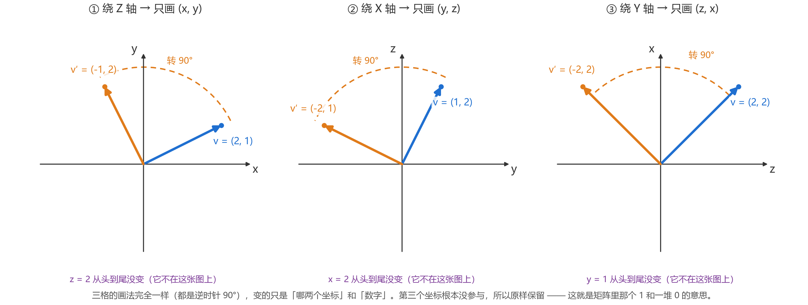

# 三维旋转：其实就是"冻结一个坐标，转另外两个"

> 这篇是给"二维能理解、三维卡住"的人写的。不推导、不背公式，只用几个具体数字把三维拆回二维。

---

## 0. 先说清楚你卡在哪（大概率是这三件事之一）

1. **二维只有一个"转"**，三维有无数个：绕 x 转、绕 y 转、绕 z 转，还有绕斜着的轴转。
   于是问题从"怎么转"变成了"**绕什么转**"——这是多出来的第一件事。
2. **屏幕上的三维图是投影**。一个 90° 的转动，画在纸上可能只看着像 40°；圆看着像椭圆；等长的箭头看着一长一短。
   所以你越盯着图看越不信 —— 不是你想不通，是图在骗你。
3. **矩阵有 9 个数**，看着像"三个旋转搅在一起"。其实没有，它只是"两个数在转、一个数不动"的记账单。

**一句话结论：三维绕定轴转，和二维一模一样；多的只是"挑哪两个坐标"。**

---

## 1. 用具体数字做一次实验

取一个向量 `v = (2, 1, 2)`，分别绕三根轴各转 90°：

| 绕哪根轴 | 转之前 | 转之后 | 谁没动 |
|---|---|---|---|
| Z | ( **2**, **1**, 2 ) | ( **−1**, **2**, 2 ) | z = 2 → 2 |
| X | ( 2, **1**, **2** ) | ( 2, **−2**, **1** ) | x = 2 → 2 |
| Y | ( **2**, 1, **2** ) | ( **2**, 1, **−2** ) | y = 1 → 1 |

盯着这张表看 30 秒，你会发现：

- 每一行里**只有一个数没变**（加粗之外的那个），其余两个数换了位置、变了符号；
- 变的那两个数，做的事**完全一样**：`(a, b) → (−b, a)`。

```
(2, 1) → (−1, 2)      绕 Z：在 (x, y) 平面里
(1, 2) → (−2, 1)      绕 X：在 (y, z) 平面里
(2, 2) → (−2, 2)      绕 Y：在 (z, x) 平面里
```

`(a, b) → (−b, a)` 就是**逆时针 90°**，也就是你已经会的那个二维旋转。

---

## 2. 把三维"按下去"（图 8）



三格画的是**同一个动作**，只是坐标轴换了名字、数字换了：

- 都是一根蓝箭头转 90° 变成橙箭头；
- 都是逆时针；
- 每格里只出现两个坐标 —— 第三个坐标根本没上场，所以它当然不变。

**这就是三维旋转的全部秘密：挑两个坐标，做二维旋转，第三个原样抄下来。**

---

## 3. 矩阵就是这张记账单

既然"绕 z 转"只动 x、y，不动 z，那么矩阵写成：

```
        [ cosθ  −sinθ    0 ]   ← 新的 x 由 x、y 算
Rz(θ) = [ sinθ   cosθ    0 ]   ← 新的 y 由 x、y 算
        [   0      0     1 ]   ← 新的 z 就是旧的 z（1 的意思：原样抄）
```

那个孤零零的 `1` 和那一串 `0`，意思不是"数学技巧"，而是：

> **这一行不参与运算，z 直接抄过去。**

绕 x、绕 y 同理，只是把"原样抄"的那一行挪个位置：

```
Rx：第 1 行是 1 0 0     ← x 原样抄
Ry：第 2 行是 0 1 0     ← y 原样抄
Rz：第 3 行是 0 0 1     ← z 原样抄
```

**"矩阵里那个 1 在第几行，就是绕第几根轴转。"** 这一条记牢，三个矩阵不用背。

（`Rz` 的第一行为什么是 `cosθ −sinθ`？因为新的 x = 旧 x 的 cosθ 倍 减去 旧 y 的 sinθ 倍 —— 这就是你在二维里已经接受的那件事，一个字都没变。）

---

## 4. 轴斜着的时候怎么办？还是二维

真实的转轴很少正好是坐标轴。这时候用同一个套路：**把 v 拆成两段**。

```
v = 沿轴的一段（par）  +  垂直于轴的一段（pp）
```

- **沿轴那一段**：转轴上的向量转完还是自己 ⇒ 一动不动（这就是矩阵里那个 1）；
- **垂直那一段**：它躺在一个**垂直于轴的平面**里，这个平面就是个普通二维平面 ⇒ 用你会的二维旋转；
- 最后把两段拼回去。

写成一句话（这就是 Rodrigues 公式的向量版）：

```
v′ = par + 转过的 pp
   = (v·â)â + cosθ·[ v − (v·â)â ] + sinθ·( â × v )
       └不动┘   └──── 二维旋转 ────┘
```

### 一个能算出来的例子

轴 `â = (1,1,0)/√2`（斜 45°），向量 `v = (1,0,0)`，转 90°：

```
第 1 步  沿轴分量： v·â = 1/√2 ≈ 0.7071
         par = 0.7071 × â = (0.5, 0.5, 0)

第 2 步  垂直分量： pp = v − par = (0.5, −0.5, 0)，长度 0.7071

第 3 步  在垂直平面里转 90°：
         转 90° 有个特别省事的算法 —— 直接算 â × pp
         â × pp = (0.7071, 0.7071, 0) × (0.5, −0.5, 0) = (0, 0, −0.7071)
         长度刚好也是 0.7071，方向就是转完 90° 的方向 ✔

第 4 步  拼回去： v′ = (0.5, 0.5, 0) + (0, 0, −0.7071) = (0.5, 0.5, −0.7071)
```

用矩阵算也是这个数（`R·v = (0.5, 0.5, −0.7071)`），两条路对得上。

**注意第 3 步**：这里没有"角度投影"之类的玄学，就是"在那张垂直的纸上，把箭头转 90°"。
斜轴和坐标轴的区别只有一个：**那张纸是斜的**。

> 转 90° 时 `pp′ = â × pp` 这个捷径值得记 —— 叉乘在这里就是"在垂直平面里逆时针拧 90°"。

---

## 5. 为什么三维图会让你产生"我不懂"的错觉

看这张表就明白了：

| 你以为图上应该看到 | 实际画在纸上 |
|---|---|
| 90° 的转角 | 可能只有 30°～50°，取决于视角 |
| 等长的箭头 | 一长一短（朝屏幕里那段被压短了） |
| 一个圆 | 一个扁椭圆 |

**投影只保留"关系"，不保留"角度和长度"。** 所以：

- 看图时，只看**方向关系**（谁在谁上方、谁和谁垂直）；
- 判断数值时，**只信坐标**，不要用眼睛量。

这也解释了为什么很多人"二维能看懂"：二维图**没有投影**，纸面就是那个平面。

---

## 6. 三个自测题（能答出来就是真懂了）

1. 轴上的向量（比如 `(0,0,5)` 绕 z 轴转），转完是什么？
   → 还是 `(0,0,5)`。因为它"沿轴"，沿轴的分量永远不动。

2. `(1,0,0)` 绕 z 轴转 90° 到哪？绕 y 轴转 90° 呢？
   → 绕 z：`(0,1,0)`（在 xy 平面里逆时针）；绕 y：`(0,0,−1)`（在 zx 平面里逆时针，x 转向 −z）。
   两个答案不一样，正说明"**轴不同，结果就不同**"。

3. 为什么 `Rz` 的第三行是 `0 0 1`？
   → 因为绕 z 转时 z 坐标不参与，原样抄过去。那个 1 就是"抄"的意思。

---

## 7. 如果还是卡，八成是这两个混淆

| 混淆 | 分辨方法 |
|---|---|
| **转物体** 还是 **转坐标系** | 转物体：同一个点在新位置（主动）；转坐标系：同一个点在新坐标下读数变了（被动）。两者差一个**转置**（等价于转 −θ）。做工程时先问一句"我转的是谁"。 |
| **角度** 和 **轴** 是一对 | 三维旋转需要两个信息：**绕什么**（一根轴）+ **转多少**（一个角）。只给角度是不够的 —— 这正是三维比二维多出来的那件事。 |

---

## 8. 一张对照表收尾

| | 二维 | 三维 |
|---|---|---|
| 转什么 | 一个平面里的箭头 | 空间里的箭头 |
| 需要几个信息 | 1 个（角度） | 2 个（轴 + 角度） |
| 有几个"转法" | 1 种 | 无穷多种（每根轴一种） |
| 转的时候 | 所有分量都在动 | **两个分量动，一个不动** |
| 矩阵 | 2×2 | 3×3（多出来的一行是 `0 0 1`） |
| 难点 | 无 | 挑平面、看图被投影骗 |

**记住最后这一句就够了：三维旋转 = 挑两个坐标做二维旋转 + 第三个坐标原样抄。**
