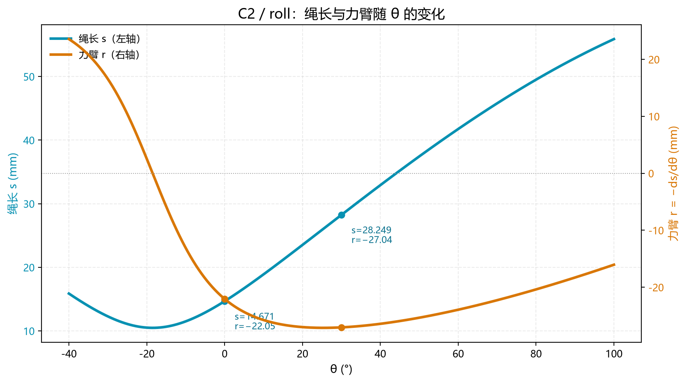
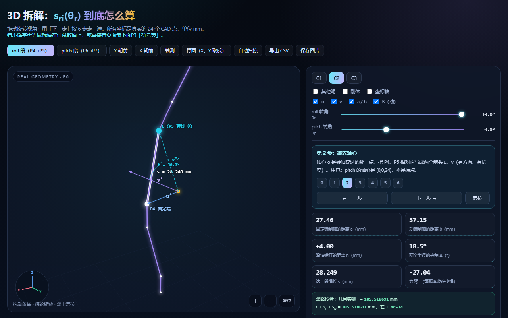
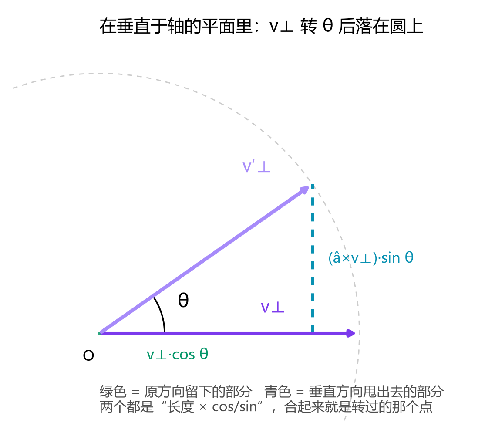
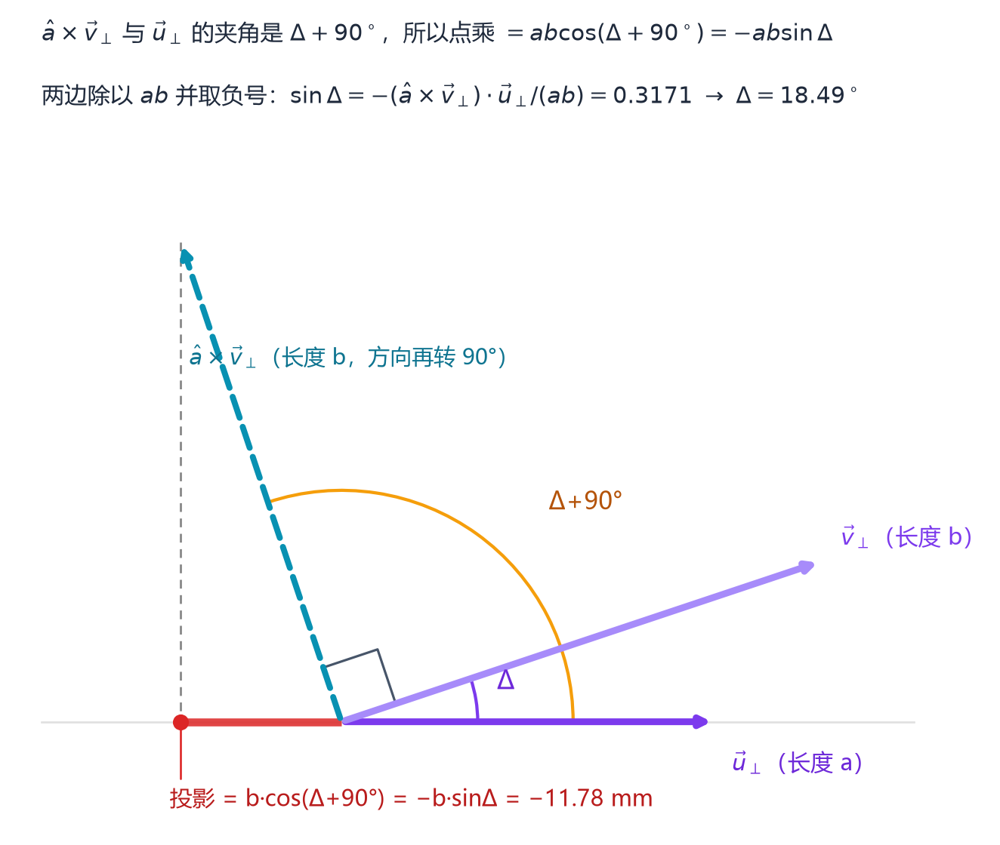
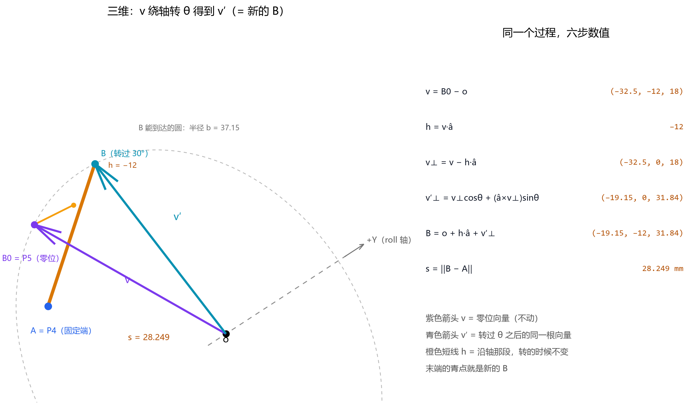
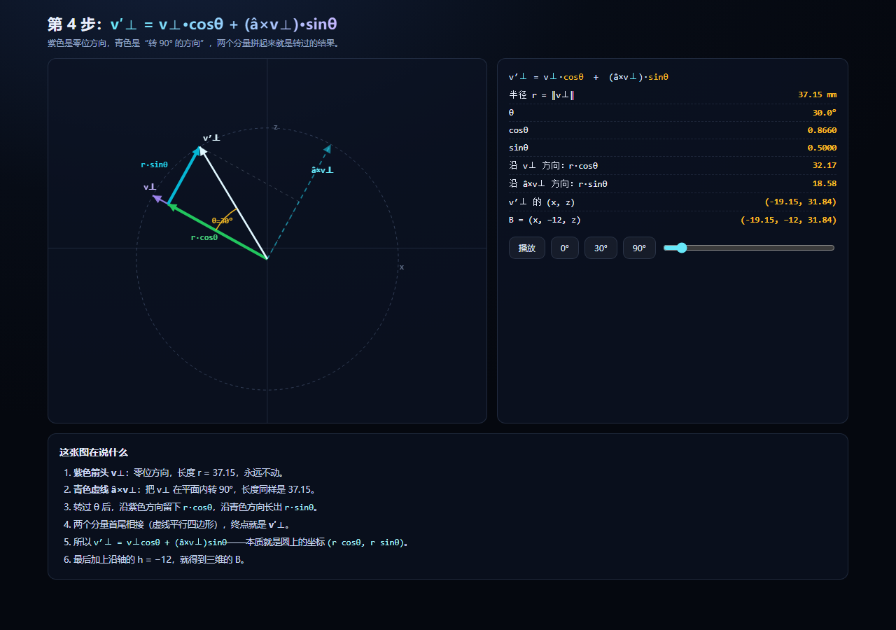

# 绳驱二轴腕部动态 R 矩阵解算

Dynamic Jacobian–Moment-Arm Matrix for a Tendon-Driven Two-Axis Wrist

徐钰　陈梓贤

SLAIHAND

技术报告　TR-WRIST-2026-01　|　2026 年 10 月 29 日

---

## 摘要

针对 3 绳驱动 2 自由度（roll、pitch）的冗余腕部构型，本文给出力臂矩阵 $R$ 的解析解算方法。由于绳与转轴的相对位置随姿态改变，力臂不为常数；在 ±30° 范围内，C2 绳的 roll 力臂由 −22.05 mm 变化至 −27.12 mm（25° 处），相对变化 23.0%。本文由虚功原理导出 $R=-\left(\partial\vec{l}/\partial q\right)^{\mathrm T}$，将每段绳长写成 $s^2=\alpha+\beta\cos\theta+\gamma\sin\theta$ 的闭式，对角度求导得到 $r=-ds/d\theta=\left(\beta\sin\theta-\gamma\cos\theta\right)/(2s)$。每段仅需 5 个几何常数，单次计算量为 2 次三角函数、4 次乘法与 1 次开方；在 9 249 个姿态上与双精度参考解的最大偏差为 $4.67\times10^{-5}$ mm。

<strong>关键词</strong>：绳驱腕部；冗余驱动；力臂矩阵；雅可比；余弦定理

---

## 符号表

| 符号 | 含义 | 单位 |
|---|---|---|
| $\vec{o}$ | 轴心（roll 段为原点，pitch 段为 $(0,0,24)$） | mm |
| $\hat{a}$ | 转轴方向单位向量（roll 为 $+Y$，pitch 为 $+X$） | — |
| $\vec{A}$ | 固定端坐标（P4 / P6） | mm |
| $\vec{B}_0$ | 动端零位坐标（P5 / P7） | mm |
| $\vec{B}(\theta)$ | 动端当前坐标 | mm |
| $a,\ b$ | 固定端、动端到转轴的距离（半径） | mm |
| $h$ | 两端沿轴错开量（带符号） | mm |
| $\Delta$ | 两条半径的有向夹角 | rad |
| $\theta$ | 关节转角（右手为正） | rad |
| $s$ | 单段绳长 | mm |
| $r$ | 力臂，$r=-ds/d\theta$ | mm |
| $R$ | 力臂矩阵，$2\times3$ | mm |
| $\vec{f}$ | 绳张力 | N |
| $\vec{\tau}$ | 关节力矩 | N·mm |

> 约定：向量记作 $\vec{x}$，单位向量记作 $\hat{x}$，标量用斜体；角度内部一律用弧度，仅在显示时换算为度。

---

## 1　引言

### 1.1　构型与问题

腕部由 3 根绳驱动 2 个自由度，属 $n+1$ 冗余驱动。绳的一端固定于基座，另一端固定于转子，中途绕过关节；关节转动时，绳与转轴的相对位置改变，故力臂随姿态变化。

### 1.2　力臂并非常数

以 C2 绳的 roll 段为例（图 1），力臂在零位为 −22.05 mm，30° 时为 −27.04 mm。

<em>图 1　绳长 s 与力臂 r 随关节角的变化（C2 / roll）</em>

若采用零位标定的常数矩阵，将带来三方面误差：

1. ±30° 内力臂变化约 23.0%，力矩估计同比例失真；
2. 三根绳的力臂量级相差两个数量级（C1 约 −0.26，C2 约 −22.05），无法以统一系数补偿；
3. 在张力分配 $\vec{f}=R^{+}\vec{\tau}+t\vec{w}$ 中，$R$ 的误差会转化为零空间方向的漂移。

### 1.3　本文工作

给出 $R$ 的解析解：由 5 个几何常数与关节角直接计算，不依赖查表或迭代，适用于嵌入式平台逐周期运行。

---

## 2　R 矩阵的定义

### 2.1　力矩映射

给定张力 $\vec{f}\in\mathbb{R}^{3}$，关节力矩 $\vec{\tau}\in\mathbb{R}^{2}$ 由线性映射给出：

$$\vec{\tau}=R\,\vec{f} \tag{1}$$

### 2.2　虚功原理

设关节角速度 $\dot{q}=(\dot\theta_r,\dot\theta_p)$，绳长变化率由链式法则给出：

$$\dot{\vec{l}}=J\,\dot{q},\qquad J=\frac{\partial\vec{l}}{\partial q}\in\mathbb{R}^{3\times2} \tag{2}$$

绳缩短时对外做功，故绳的功率为

$$P_{\text{rope}}=-\vec{f}^{\mathrm T}\dot{\vec{l}}=-\vec{f}^{\mathrm T}J\,\dot{q} \tag{3}$$

关节侧功率为

$$P_{\text{joint}}=\vec{\tau}^{\mathrm T}\dot{q} \tag{4}$$

由 $P_{\text{rope}}=P_{\text{joint}}$ 对任意 $\dot{q}$ 成立，得

$$\vec{\tau}^{\mathrm T}=-\vec{f}^{\mathrm T}J\quad\Longrightarrow\quad\vec{\tau}=-J^{\mathrm T}\vec{f} \tag{5}$$

### 2.3　定义

$$R=-J^{\mathrm T}=-\left(\frac{\partial\vec{l}}{\partial q}\right)^{\mathrm T} \tag{6}$$

$R$ 为 $2\times3$ 矩阵：行为关节，列为绳。因矩阵非方阵，反解需用伪逆并引入零空间偏置：

$$\vec{f}=R^{+}\vec{\tau}+t\,\vec{w} \tag{7}$$

其中 $\vec{w}$ 为零空间向量，$t$ 为标量，用于保证张力非负（预张紧）。

---

## 3　几何模型

### 3.1　坐标系

原点取 roll 轴上距 pitch 轴最近的点；roll 轴过原点、方向 $+Y$；pitch 轴过 $(0,0,24)$、方向 $+X$；两轴构成右手系。需注意 pitch 轴**不过原点**。

### 3.2　解耦条件

每段绳只跨一个关节，因此

$$l=c+s_r(\theta_r)+s_p(\theta_p) \tag{8}$$

式中 $c$ 为常数长度。图 2 为解算过程对应的交互页面。

<em>图 2　交互页面第 2 步：紫线为零位向量 $\vec{v}$，青虚线为转过 $\theta$ 后的 $\vec{v}'$</em>

---

## 4　绳长推导

### 4.1　相对轴心的位置向量

$$\vec{u}=\vec{A}-\vec{o},\qquad \vec{v}=\vec{B}_0-\vec{o} \tag{9}$$

### 4.2　分解为轴向与垂直分量

$$h_1=\vec{u}\cdot\hat{a},\qquad \vec{u}_\perp=\vec{u}-h_1\hat{a} \tag{10}$$

$$h_2=\vec{v}\cdot\hat{a},\qquad \vec{v}_\perp=\vec{v}-h_2\hat{a} \tag{11}$$

$$a=\|\vec{u}_\perp\|,\qquad b=\|\vec{v}_\perp\|,\qquad h=h_2-h_1 \tag{12}$$

式 (12) 中三个量与 $\theta$ 无关，为几何常数。

### 4.3　旋转

绕轴旋转仅作用于垂直分量：

$$\mathrm{Rot}(\theta)\,\vec{v}_\perp=\vec{v}_\perp\cos\theta+(\hat{a}\times\vec{v}_\perp)\sin\theta \tag{13}$$

$$\vec{B}(\theta)=\vec{o}+h_2\hat{a}+\mathrm{Rot}(\theta)\,\vec{v}_\perp \tag{14}$$

<em>图 3　垂直平面内的分解：径向 $r\cos\theta$ 与切向 $r\sin\theta$</em>

### 4.4　距离平方

$$\vec{B}-\vec{A}=h\,\hat{a}+\left(\mathrm{Rot}(\theta)\,\vec{v}_\perp-\vec{u}_\perp\right) \tag{15}$$

轴向与垂直方向正交，平方时可分离：

$$s^2=h^2+\left\|\mathrm{Rot}(\theta)\,\vec{v}_\perp-\vec{u}_\perp\right\|^2 \tag{16}$$

$$s^2=a^2+b^2+h^2-2\,\mathrm{Rot}(\theta)\,\vec{v}_\perp\cdot\vec{u}_\perp \tag{17}$$

### 4.5　余弦定理形式

垂直平面内两条半径的夹角为 $\Delta+\theta$，由余弦定理

$$s^2=a^2+b^2+h^2-2ab\cos(\Delta+\theta) \tag{18}$$

夹角的有向性由点乘与叉乘共同确定：

$$\cos\Delta=\frac{\vec{v}_\perp\cdot\vec{u}_\perp}{ab},\qquad \sin\Delta=-\frac{(\hat{a}\times\vec{v}_\perp)\cdot\vec{u}_\perp}{ab} \tag{19}$$

> 说明：$\hat{a}\times\vec{v}_\perp$ 等价于将 $\vec{v}_\perp$ 绕 $\hat{a}$ 旋转 $90°$；其与 $\vec{u}_\perp$ 的夹角为 $\Delta+90°$，故 $\cos(\Delta+90°)=-\sin\Delta$，负号由此而来（图 4）。

<em>图 4　$\sin\Delta$ 的几何解释：叉乘旋转 90° 后投影为负</em>

### 4.6　闭式

$$s^2=\alpha+\beta\cos\theta+\gamma\sin\theta \tag{20}$$

$$\alpha=a^2+b^2+h^2,\qquad \beta=-2\,\vec{v}_\perp\cdot\vec{u}_\perp,\qquad \gamma=2ab\sin\Delta \tag{21}$$

---

## 5　力臂推导

### 5.1　求导法则

| 法则 | 表达式 |
|---|---|
| 常数 | $(\alpha)'=0$ |
| 余弦 | $(\cos\theta)'=-\sin\theta$ |
| 正弦 | $(\sin\theta)'=+\cos\theta$ |
| 常数倍 | $(\beta\cos\theta)'=-\beta\sin\theta$ |
| 链式 | $\left[f(\theta)^n\right]'=n\,f(\theta)^{n-1}f'(\theta)$ |

### 5.2　一阶导数

记

$$f(\theta)=\alpha+\beta\cos\theta+\gamma\sin\theta \tag{22}$$

则

$$f'(\theta)=\gamma\cos\theta-\beta\sin\theta \tag{23}$$

由 $s=f^{1/2}$ 与链式法则，

$$\frac{ds}{d\theta}=\frac{f'(\theta)}{2\sqrt{f(\theta)}}=\frac{\gamma\cos\theta-\beta\sin\theta}{2s} \tag{24}$$

等价地，对式 (20) 两端求导：

$$2s\frac{ds}{d\theta}=\gamma\cos\theta-\beta\sin\theta \tag{25}$$

### 5.3　力臂定义

按式 (6) 的符号约定，

$$r=-\frac{ds}{d\theta}=\frac{\beta\sin\theta-\gamma\cos\theta}{2s} \tag{26}$$

零位时 $\cos0=1$、$\sin0=0$，故

$$r(0)=-\frac{\gamma}{2\sqrt{\alpha+\beta}}=-\frac{\gamma}{2s_0} \tag{27}$$

### 5.4　逐步算例（C2 / roll，$\theta=30°$）

| 步骤 | 计算 | 结果 |
|---|---|---|
| $\cos30°$ / $\sin30°$ | — | 0.86603 / 0.50000 |
| $\gamma\cos\theta$ | $647\times0.86603$ | 560.32 |
| $-\beta\sin\theta$ | $-(-1935)\times0.5$ | +967.50 |
| 分子 $f'$ | $560.32+967.50$ | 1527.82 |
| 分母 $2s$ | $2\times28.249$ | 56.498 |
| $ds/d\theta$ | $1527.82/56.498$ | **27.04 mm/rad** |
| $r=-ds/d\theta$ | — | **−27.04 mm** |

### 5.5　差分校核

由式 (20) 直接计算两个相邻角度：

$$s(30°)=28.249\ \text{mm},\qquad s(31°)=28.720\ \text{mm} \tag{28}$$

$$\frac{\Delta s}{\Delta\theta}=\frac{0.471}{\pi/180}\approx26.99\ \text{mm/rad} \tag{29}$$

与式 (24) 的 27.04 mm/rad 相差 0.2%，差异源于差分步长。

### 5.6　力臂对角度的导数

线性化时需用到

$$r'(\theta)=\frac{(\beta\cos\theta+\gamma\sin\theta)\,s+(\beta\sin\theta-\gamma\cos\theta)\,s'}{2s^{2}} \tag{30}$$

---

## 6　R 矩阵的组装

$$R_{ij}=-\frac{\partial l_i}{\partial q_j}=-\frac{ds_{ij}}{d\theta_j}=r_{ij}(\theta_j) \tag{31}$$

零位数值见表 1。

<em>表 1　零位力臂（mm）</em>

| | C1 | C2 | C3 |
|---|---|---|---|
| **roll** | −0.259 | −22.050 | +17.372 |
| **pitch** | −58.105 | +11.805 | +10.990 |

两段的差异汇总于表 2。

<em>表 2　两段的几何参数</em>

| 项 | roll | pitch |
|---|---|---|
| 轴心 $\vec{o}$ | $(0,0,0)$ | $(0,0,24)$ |
| 轴 $\hat{a}$ | $+Y$ | $+X$ |
| 端点 | P4、P5 | P6、P7 |

---

## 7　工程实现

### 7.1　五常数形式

将第 4 章结果压缩为 $u_1,u_2,v_1,v_2,h$，运行时计算

$$d_1=v_1\cos\theta-v_2\sin\theta-u_1 \tag{32}$$
$$d_2=v_1\sin\theta+v_2\cos\theta-u_2 \tag{33}$$
$$s=\sqrt{d_1^2+d_2^2+h^2},\qquad r=\frac{u_2d_1-u_1d_2}{s} \tag{34}$$

### 7.2　计算量与精度

| 指标 | 数值 |
|---|---|
| 单段三角函数 | 2 次 |
| 单段乘法 | 4 次 |
| 单段开方 | 1 次 |
| 全姿态验证点数 | 9 249 |
| float32 与 double 最大偏差 | $4.67\times10^{-5}$ mm |

---

## 8　数值验证

以 C2 绳的 roll 段、$\theta=30°$ 为例：

$$\vec{v}=(-32.5,-12,18),\qquad \vec{v}_\perp=(-32.5,0,18),\qquad h=-12 \tag{35}$$

$$\mathrm{Rot}(\theta)\,\vec{v}_\perp=(-19.145,\,0,\,31.839) \tag{36}$$

$$\vec{B}=(-19.145,\,-12,\,31.839) \tag{37}$$

$$s=\|\vec{B}-\vec{A}\|=\sqrt{7.855^{2}+4^{2}+26.838^{2}}=28.249\ \text{mm} \tag{38}$$

<em>图 5　$\vec{B}$ 点的三维示意（C2 / roll，$\theta=30°$）</em>

多角度对照见表 3。

<em>表 3　C2 / roll 的绳长与力臂</em>

| $\theta$ | $s$ (mm) | $r$ (mm) |
|---|---|---|
| 0° | 14.671 | −22.050 |
| 25° | 25.884 | −27.124 |
| 30° | 28.249 | −27.04 |

---

## 9　结论

1. 力臂随姿态变化，$\pm30°$ 内变化 23.0%，因此 $R$ 必须作为关节角的函数实时计算。
2. 由虚功原理可直接导出 $R=-\left(\partial\vec{l}/\partial q\right)^{\mathrm T}$，无需引入额外假设。
3. 单段绳长具有 $s^2=\alpha+\beta\cos\theta+\gamma\sin\theta$ 的闭式，力臂由其对角度求导取负得到。
4. 五常数实现的计算量为每段 2 次三角函数、4 次乘法、1 次开方，满足嵌入式实时性要求。

---

## 10　常见错误

| 错误 | 后果 |
|---|---|
| 将 pitch 轴心取为原点 | 力臂偏差约 24 mm 量级 |
| 以 $\|\vec{v}\|$ 作为半径 $b$ | 未扣除轴向分量 |
| 将 $r$ 记为 $+ds/d\theta$ | 控制方向相反，闭环发散 |
| 角度以度直接代入三角函数 | 结果错误 |

---

## 附录 A　交互工具

| 文件 | 内容 |
|---|---|
| `3D_拆解_sri.html` | 六步拆解，可拖动旋转、调节角度、开关图层 |
| `第4步_动画.html` | 垂直平面内旋转动画，实时显示 $\cos$、$\sin$ 分量 |

<em>图 6　第 4 步动画：绿色为 $r\cos\theta$，青色为 $r\sin\theta$，白色为合成结果</em>

---

## 附录 B　修订记录

| 日期 | 版本 | 修改 |
|---|---|---|
| 2026-10-22 | v1.0 | 初稿：推导与标定 |
| 2026-10-26 | v1.1 | 补 30° 算例与 $r(\theta)$ 曲线 |
| 2026-10-27 | v1.2 | 重写需求来源，补充插图 |
| 2026-10-28 | v2.0 | 新增虚功原理与详细求导 |
| 2026-10-28 | v2.1 | 按学术体例重排：摘要、符号表、公式编号、图表编号 |
| 2026-10-29 | v2.2 | 补充作者署名 |
| 2026-10-29 | v2.3 | 修正表 3 的 25° 力臂（−26.99 → −27.124，−26.99 实为 20° 的值）；摘要与结论中的相对变化同步改为 23.0% |
