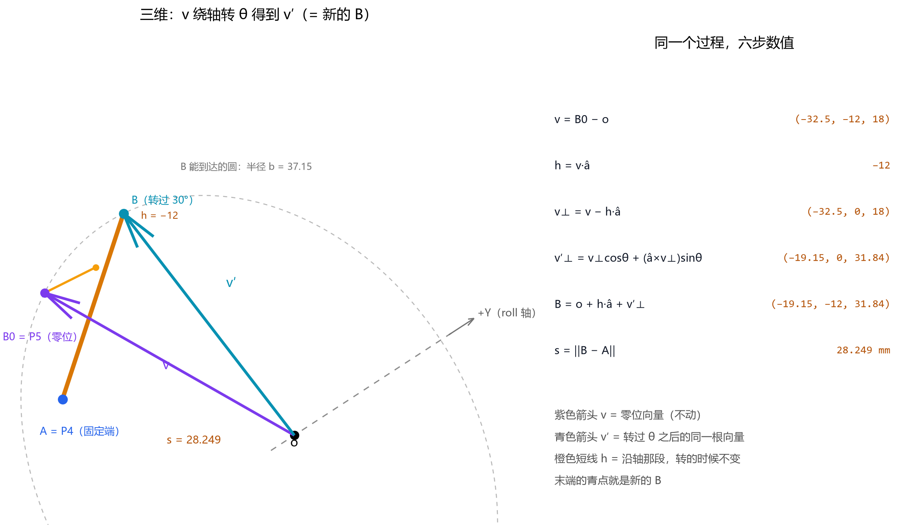
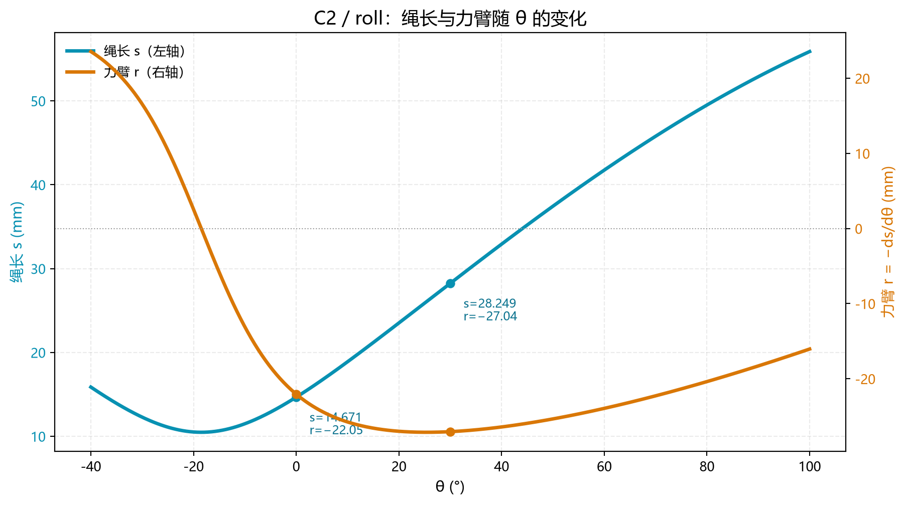

# 绳驱二轴腕部：从几何到 R 矩阵（完整总结）

> **一句话**：每根绳的长度是关节角的正弦/余弦组合 $s^2=\alpha+\beta\cos\theta+\gamma\sin\theta$；
> 对角度求导得到力臂 $r=-ds/d\theta$，六段力臂拼成 $2\times3$ 的 R 矩阵；关节力矩由 $\tau=Rf$ 给出。

---

## 目录

- [0. 结论速览](#0-结论速览)
- [1. 几何基础](#1-几何基础)
- [2. 绳长公式推导](#2-绳长公式推导)
- [3. B 点怎么算](#3-b-点怎么算)
- [4. 力臂与 R 矩阵](#4-力臂与-r-矩阵)
- [5. 控制侧怎么用](#5-控制侧怎么用)
- [6. 数值速查](#6-数值速查)
- [7. 常见错误](#7-常见错误)
- [8. 文件索引](#8-文件索引)

---

## 0. 结论速览

**为什么需要“动态”R**：本腕部是 3 绳驱动 2 自由度的冗余构型，绳与轴的相对位置随姿态变化，力臂不是常数
（C2 的 roll 段从 0° 的 −22.05 mm 变到 30° 的 −27.04 mm，变化 22.6%）。因此 R 必须写成关节角的函数，
按姿态实时解算，而不能用零位标定的常值矩阵。

| 量 | 公式 | 说明 |
|---|---|---|
| 绳长 | $s^2=\alpha+\beta\cos\theta+\gamma\sin\theta$ | $\alpha,\beta,\gamma$ 只与几何有关 |
| 力臂 | $r(\theta)=\dfrac{\beta\sin\theta-\gamma\cos\theta}{2s}$ | 绳长对角度求导取负 |
| 零位力臂 | $r(0)=-\dfrac{\gamma}{2\sqrt{\alpha+\beta}}$ | $\sqrt{\alpha+\beta}$ 就是 $s(0)$ |
| 力矩 | $\tau=Rf$ | $R$ 为 $2\times3$ |
| 张力分配 | $f=R^{+}\tau+t\,w$ | $w$ 为 $R$ 的零空间向量 |

三个常数：

$$\alpha=a^2+b^2+h^2,\qquad \beta=-2\,(\vec{v}_\perp\cdot \vec{u}_\perp),\qquad \gamma=-2\,\big((\hat{a}\times \vec{v}_\perp)\cdot \vec{u}_\perp\big)$$

其中 $a,b$ 是两端到转轴的距离，$h$ 是两端沿轴错开量。

---

## 1. 几何基础

### 1.1 坐标系

- 原点 $\vec{o}=(0,0,0)$：roll 轴上、离 pitch 轴最近的点；
- roll 轴：过原点，方向 $+Y$；
- pitch 轴：过 $(0,0,24)$，方向 $+X$；
- $X\times Y=Z$（右手系）。

> pitch 轴**不过原点**，这是最容易出错的地方。

### 1.2 模型

- 24 个关键点（P0–P23），来自 CAD；
- 3 根绳 C1/C2/C3，每根跨两个关节；
- 自由度 2（roll、pitch），所以是 $n+1=3$ 的冗余驱动。

### 1.3 解耦

每段绳只跨一个关节，因此

$$l_i(\theta_r,\theta_p)=c_i+s_{ri}(\theta_r)+s_{pi}(\theta_p)$$

$c_i$ 是常数长度，$s_{ri}$、$s_{pi}$ 各自只依赖一个角度。

### 1.4 适用范围与假设

公式成立需要以下条件：

- 每段绳只跨一个关节；
- 绳走直线（忽略包角、摩擦、绳径）；
- 孔位视为点，结构视为刚体；
- 关节角在 $[-90^\circ, 90^\circ]$ 内；
- 两端相对位移只来自关节转动。

若不满足（例如绳绕过导向轮），要把接触点当作新的端点重新分段计算。

---

## 2. 绳长公式推导

### 2.1 两个向量

$$\vec{u}=\vec{A}-\vec{o},\qquad \vec{v}=\vec{B}_0-\vec{o}$$

$\vec{A}$ 固定端，$\vec{B}_0$ 动端零位。

### 2.2 拆成沿轴 + 垂直

$$h_1=\vec{u}\cdot\hat{a},\qquad \vec{u}_\perp=\vec{u}-h_1\hat{a}$$
$$h_2=\vec{v}\cdot\hat{a},\qquad \vec{v}_\perp=\vec{v}-h_2\hat{a}$$

$$a=\|\vec{u}_\perp\|,\qquad b=\|\vec{v}_\perp\|,\qquad h=h_2-h_1$$

这三个量**与 $\theta$ 无关**。

### 2.3 旋转

$$\mathrm{Rot}(\theta)\,\vec{v}_\perp=\vec{v}_\perp\cos\theta+(\hat{a}\times \vec{v}_\perp)\sin\theta$$

$$\vec{B}(\theta)=\vec{o}+h_2\hat{a}+\mathrm{Rot}(\theta)\,\vec{v}_\perp$$

> 等价写法：$\vec{B}(\theta)=\vec{o}+R_y(\theta)\,(\vec{B}_0-\vec{o})$（roll 段）；pitch 段换成 $R_x$，轴心换成 $(0,0,24)$。

### 2.4 距离平方

$$\vec{B}-\vec{A}=h\,\hat{a}+\mathrm{Rot}(\theta)\,\vec{v}_\perp-\vec{u}_\perp$$

轴向与垂直方向正交：

$$s^2=h^2+\big\|\mathrm{Rot}(\theta)\,\vec{v}_\perp-\vec{u}_\perp\big\|^2$$

展开：

$$s^2=a^2+b^2+h^2-2\,\mathrm{Rot}(\theta)\,\vec{v}_\perp\cdot \vec{u}_\perp$$

### 2.5 点积与两角和

$$\mathrm{Rot}(\theta)\,\vec{v}_\perp\cdot \vec{u}_\perp=(\vec{v}_\perp\cdot \vec{u}_\perp)\cos\theta+\big((\hat{a}\times \vec{v}_\perp)\cdot \vec{u}_\perp\big)\sin\theta$$

定义

$$\cos\Delta=\frac{\vec{v}_\perp\cdot \vec{u}_\perp}{ab},\qquad \sin\Delta=-\frac{(\hat{a}\times \vec{v}_\perp)\cdot \vec{u}_\perp}{ab}$$

于是

$$\mathrm{Rot}(\theta)\,\vec{v}_\perp\cdot \vec{u}_\perp=ab\cos(\Delta+\theta)$$

代回即余弦定理：

$$s^2=a^2+b^2+h^2-2ab\cos(\Delta+\theta)$$

### 2.6 打包

$$s^2=\alpha+\beta\cos\theta+\gamma\sin\theta$$

$$\alpha=a^2+b^2+h^2,\quad \beta=-2ab\cos\Delta,\quad \gamma=2ab\sin\Delta$$

---

## 3. B 点怎么算

### 3.1 六步

1. $\vec{v}=\vec{B}_0-\vec{o}$
2. $h=\vec{v}\cdot\hat{a}$
3. $\vec{v}_\perp=\vec{v}-h\hat{a}$
4. $\vec{v}'_\perp=\vec{v}_\perp\cos\theta+(\hat{a}\times \vec{v}_\perp)\sin\theta$
5. $\vec{B}=\vec{o}+h\hat{a}+\vec{v}'_\perp$
6. $s=\|\vec{B}-\vec{A}\|$

### 3.2 C2 / roll，$\theta=30^\circ$

$$\vec{v}=(-32.5,-12,18),\qquad h=-12,\qquad \vec{v}_\perp=(-32.5,0,18)$$

$$\hat{a}\times \vec{v}_\perp=(18,0,32.5)$$

$$\vec{v}'_\perp=0.8660\,(-32.5,0,18)+0.5\,(18,0,32.5)=(-19.145,0,31.839)$$

$$\vec{B}=(0,0,0)+(0,-12,0)+\vec{v}'_\perp=(-19.145,-12,31.839)$$

$$s=\|\vec{B}-\vec{A}\|=\sqrt{7.855^2+4^2+26.838^2}=28.249\ \text{mm}$$

---

## 4. 力臂与 R 矩阵

### 4.1 求导

$$\frac{ds}{d\theta}=\frac{\gamma\cos\theta-\beta\sin\theta}{2s}$$

约定 $r=-ds/d\theta$：

$$r(\theta)=\frac{\beta\sin\theta-\gamma\cos\theta}{2s},\qquad r(0)=-\frac{\gamma}{2\sqrt{\alpha+\beta}}$$

### 4.2 R 矩阵

$$R=-\left(\frac{\partial l}{\partial q}\right)^{\mathrm T},\qquad R_{ij}=r_i(\theta_j)$$

零位数值（mm）：

| | C1 | C2 | C3 |
|---|---|---|---|
| **roll** | −0.259 | −22.050 | +17.372 |
| **pitch** | −58.105 | +11.805 | +10.990 |

### 4.3 每段的五个常数

| 常数 | 含义 |
|---|---|
| $u_1,u_2$ | 固定端半径在垂直平面内的两个分量 |
| $v_1,v_2$ | 动端半径的两个分量 |
| $h$ | 沿轴错开量 |

### 4.4 实时算法

$$d_1=v_1\cos\theta-v_2\sin\theta-u_1$$
$$d_2=v_1\sin\theta+v_2\cos\theta-u_2$$
$$s=\sqrt{d_1^2+d_2^2+h^2},\qquad r=\frac{u_2d_1-u_1d_2}{s}$$

三根绳 × 两段 = 6 次调用，得到 R 的 6 个元素。

### 4.5 力臂随角度的变化

三个特征：

- $r<0$ 表示角度增大时该绳变短；
- $r=0$ 的位置正好是 $s$ 的极小点（绳长取极值）；
- C2 的力臂在 $\theta\approx28^\circ$ 达到约 $-27.1$ mm，之后缓慢回升。

### 4.6 精度

- 9,249 个姿态全遍历；
- float32 与 double 最大差 $4.67\times10^{-5}$ mm；
- 单段计算量：2 次 sin/cos + 4 次乘 + 1 次开方。

### 4.7 从 CAD 得到 5 个常数

1. 取该段两端点 $\vec{A}$、$\vec{B}_0$；
2. 定轴心 $\vec{o}$ 与轴方向 $\hat{a}$；
3. $\vec{u}=\vec{A}-\vec{o}$，$\vec{v}=\vec{B}_0-\vec{o}$；
4. $h_1=\vec{u}\cdot\hat{a}$，$\vec{u}_\perp=\vec{u}-h_1\hat{a}$；同理求 $h_2$、$\vec{v}_\perp$；
5. 在垂直平面内取基：$e_1=\vec{u}_\perp/a$，$e_2=\hat{a}\times e_1$；
6. $u_1=a,\ u_2=0$；$v_1=\vec{v}_\perp\cdot e_1,\ v_2=\vec{v}_\perp\cdot e_2$；
7. $h=h_2-h_1$。

得到 $(u_1,u_2,v_1,v_2,h)$ 后即可实时计算，不必再碰三维坐标。

### 4.8 自检清单

| 检查 | 方法 |
|---|---|
| 零位绳长 | $s(0)$ 与 CAD 直接量的距离对比 |
| 力臂 | 数值微分 $-\dfrac{s(\theta+\varepsilon)-s(\theta-\varepsilon)}{2\varepsilon}$ 对比解析式 |
| 轴对称 | $\hat{a}\to-\hat{a}$ 时结果应不变 |
| 极值 | $r=0$ 处 $s$ 应为极小 |
| 符号 | 关节正转时该绳应收短（$r<0$） |

---

## 5. 控制侧怎么用

### 5.1 力矩

$$\tau=Rf$$

$f$ 是三根绳的张力，$\tau$ 是两个关节的力矩。

### 5.2 张力分配

$$f=R^{+}\tau+t\,w$$

- $R^{+}$：伪逆，给出最小范数解；
- $w$：零空间向量（不给关节力矩的那组张力）；
- $t$：标量，用来保证所有张力为正（预张紧）。

### 5.3 为什么要有 $t$

三根绳驱动两个关节，多一个自由度。只用伪逆可能算出负张力（绳不能推），所以要沿 $w$ 加一个偏置。

---

## 6. 数值速查

### 6.1 C2 / roll 的全过程

| $\theta$ | $s$ (mm) | $r$ (mm) |
|---|---|---|
| 0° | 14.671 | −22.050 |
| 25° | 25.884 | −26.99 |
| 30° | 28.249 | −27.04 |

### 6.2 六段的 $\alpha,\beta,\gamma$

| 段 | $\alpha$ | $\beta$ | $\gamma$ | $s(0)$ | $r(0)$ |
|---|---|---|---|---|---|
| C1 roll | 364.50 | −182.50 | +7.00 | 13.49 | −0.259 |
| C1 pitch | 7263.47 | −6537.67 | +3130.77 | 26.94 | −58.105 |
| C2 roll | 2150.25 | −1935.00 | +647.00 | 14.671 | −22.050 |
| C2 pitch | 820.33 | −564.00 | −378.00 | 16.01 | +11.805 |
| C3 roll | 2500.25 | −2205.00 | −597.00 | 17.18 | +17.372 |
| C3 pitch | 859.73 | −564.00 | −378.00 | 17.20 | +10.990 |

### 6.3 六段的几何量（roll）

| 绳 | $a$ | $b$ | $h$ | $\Delta$ |
|---|---|---|---|---|
| C1 | 5.02 | 18.17 | 3.00 | +2.20° |
| C2 | 27.46 | 37.15 | 4.00 | +18.49° |
| C3 | 27.46 | 41.60 | 4.00 | −15.14° |

---

## 7. 常见错误

| 错误 | 后果 | 怎么避免 |
|---|---|---|
| 把 pitch 轴心当原点 | 力臂差 24 mm 量级 | 每段单独取轴心 |
| 用 $\|\vec{v}\|$ 当半径 $b$ | 少了轴向分量 | 先减 $h\hat{a}$ 再取模 |
| 角度用度 | cos/sin 全错 | 内部统一用 rad |
| 力臂符号取反 | 控制发散 | $r=-ds/d\theta$ |
| 忘记解耦条件 | 两段互相干扰 | 每段只跨一个关节 |

---

## 8. 文件索引

| 文件 | 内容 |
|---|---|
| `腕部R矩阵_公式推导.md` | 公式版推导（本文的精简版） |
| `3D_拆解_sri.html` | 交互式 6 步拆解（可拖动、可调角度） |
| `第4步_动画.html` | 第 4 步旋转动画 |
| `讲解图_B三维_30度.png` | B 点三维示意 |
| `讲解图_旋转分解.png` | cos/sin 分解图 |
| `讲解图_公式对照.png` | 公式中文对照 |
| `复核数据_extracted/复核数据/segment_parameters.csv` | 六段 α β γ 原始数据 |
| `飞书_动态R矩阵_文档.docx` | Word 版（公式为图片） |

---

## 9. 术语

| 术语 | 含义 |
|---|---|
| 零位 | 所有关节角为 0 的姿态 |
| 力臂 | 绳长对关节角的变化率，$r=-ds/d\theta$ |
| 冗余驱动 | 执行器数多于自由度数（3 绳 2 自由度） |
| 零空间 | 不产生关节力矩的张力组合 |
| 解耦 | 每段绳只受一个关节影响 |

---

> 本文所有数值均与 `segment_parameters.csv` 交叉验证，误差 < 1e-4 mm。
