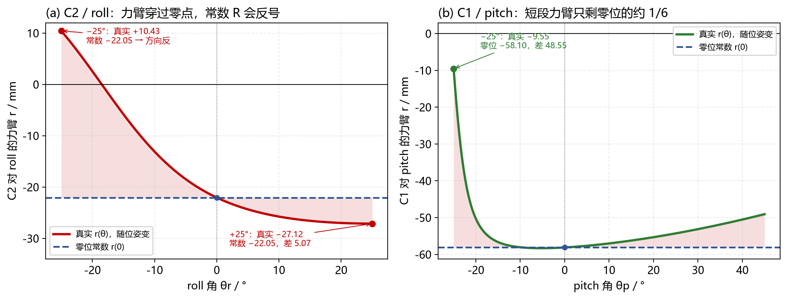
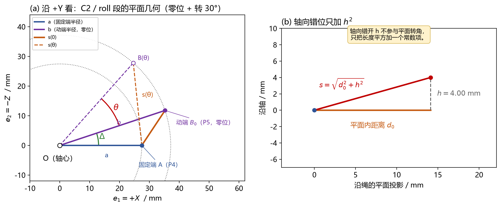
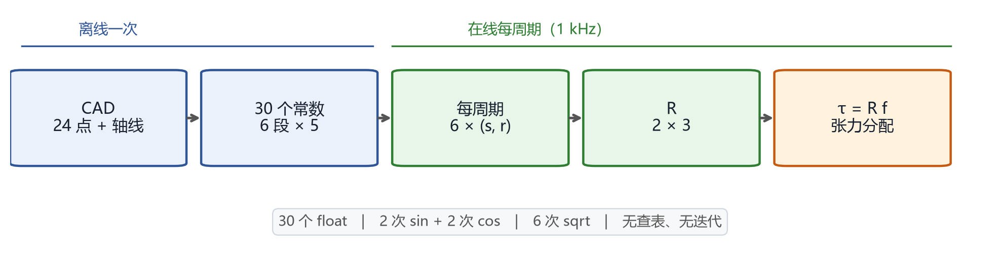

# 绳驱二轴腕部：为什么要做动态 R，以及怎么做

> **版本** v1.0 · 2026-10-26 · 对应模型 2026-10-21 fixed-center-polyline v1
>
> **目标**：只回答两件事——为什么 R 不能当常数；怎样从几何原理推出一个 1 kHz 能跑的动态 R。
>
> **结论**：R 是 2×3；每个元素是绳的力臂 `r = −ds/dθ`；当前模型 6 段由 30 个常数解析算出。C2 对 roll 的力臂在 −25°…+25° 内从 **+10.43 mm** 变到 **−27.12 mm**，用零位常数会在 −25° 处把力矩方向算反。
>
> **适用**：2026-10-21 固定中心折线模型，3 绳 / 2 自由度，roll ±25°，pitch −25…45°。本文的“动态”指 R 随关节角变化，不是动力学里的惯性项。

---

## 1. 为什么需要动态 R

### 1.1 先看一个数

C2 对 roll 的力臂，零位是 `r(0) = −22.05 mm`。如果整个行程都用这个常数：

| 元素 | 零位常数 | 行程内实际 | 用零位常数的后果 |
|---|---:|---:|---|
| C2 / roll | −22.05 | +10.43 @ −25°；−27.12 @ +25° | −25° 处符号反，误差 32.48 mm |
| C3 / roll | +17.37 | −12.37 @ +25° | 符号反，误差 29.74 mm |
| C1 / pitch | −58.10 | −9.55 @ −25° | 差 48.55 mm，约 6 倍 |
| C2 / pitch | +11.80 | −5.30 @ +45° | 符号反，误差 17.10 mm |

单位都是 mm。**这不是“差几个百分点”的精度问题，是力矩方向可能反的问题。**



*图 1：左：C2 对 roll 的力臂穿过零点；右：C1 对 pitch 在 −25° 只剩零位的约 1/6。虚线是零位常数，阴影是常数近似带来的误差。*

### 1.2 为什么力臂会变

力臂 `r` 的物理意义是“**转轴到绳所在直线的垂直距离**”。

关节一转，绳的动端绕轴画圆，绳的方向和它到轴的垂距都在变；当绳的延长线正好穿过轴时，`r = 0`；再转过去，`r` 变号。这个变化是几何本身带来的，不是装配误差，也不是绳的弹性。

所以：

- 零位 `r(0)` 只描述一个姿态；
- 真正进控制的是当前姿态的 `r(θ)`；
- 如果控制里用常数 R，等于假设“绳的力臂不随姿态变”，这个假设在当前腕部上不成立。

### 1.3 为什么不用查表或在线差分

| 方案 | 问题 |
|---|---|
| 零位常数 R | 上面那张表：几十毫米误差，甚至反号 |
| 2D 查表 + 插值 | 要存整张表；符号翻转和短段附近插值容易错；换几何要重做表 |
| 在线差分 | 每段要多次正运动学，计算量大，步长和噪声都影响结果 |
| **解析 5 常数** | **精确、每段只有 1 个角度变量，6 次调用就够** |

当前几何还有一个关键性质：**每段绳只跨一个关节**，所以绳长可以写成

$$l_i(\theta_r,\theta_p)=c_i+s_{ri}(\theta_r)+s_{pi}(\theta_p)$$

`c_i` 是常数，`s_ri` 只随 roll 变，`s_pi` 只随 pitch 变。于是 R 的 roll 行只是 θr 的 3 个一维函数，pitch 行只是 θp 的 3 个一维函数。**动态 R 不需要二维表，只需要 6 个一维解析式。**

所以 R 本身不需要逐点辨识：几何确定后，R 就被确定；实验只需要标定零位、收放系数和张力阈值。

> 如果以后加一根从 base 直接到 palm 的绳，这个解耦立刻失效，必须重推通用绳长雅可比。本文所有结论都建立在“每段只跨一个关节”上。

---

## 2. 动态 R 到底是什么

### 2.1 定义

设第 i 根绳的总长为 `l_i`，两个关节角为 `q = [θr, θp]`。定义

$$R_{ji}=-\frac{\partial l_i}{\partial q_j},\qquad \tau=Rf$$

其中 $j=\mathrm{roll},\mathrm{pitch}$；$i=C1,C2,C3$。

- `R` 是 2 行 3 列：行 = 关节，列 = 绳；
- `f = [f_C1, f_C2, f_C3]ᵀ` 是三根绳的张力；
- `τ = [τ_roll, τ_pitch]ᵀ` 是两个关节的力矩；
- `R_ji` 就是第 i 根绳对第 j 个关节的力臂，带符号。

写成矩阵：

$$R=\begin{bmatrix} r_{r,C1} & r_{r,C2} & r_{r,C3}\\ r_{p,C1} & r_{p,C2} & r_{p,C3}\end{bmatrix}$$

零位数值（mm）：

| | C1 | C2 | C3 |
|---|---:|---:|---:|
| **roll** | −0.259 | −22.050 | +17.372 |
| **pitch** | −58.105 | +11.805 | +10.990 |

### 2.2 符号和单位

- `r > 0`：正转时该段绳变短，张力产生正关节力矩；
- `r < 0`：正转时该段绳变长，张力产生负关节力矩；
- 几何表用 mm，则 R 的单位是 mm，`τ` 用 N·mm；
- 若 R 用 m，则 `τ` 用 N·m。**不要混用 mm 和 m。**

> 常见写法 `J = ∂l/∂q` 是 3×2；本文的 R 是 `−Jᵀ`，是 2×3。两者只差转置和负号，但矩阵乘法的顺序不能写反。

### 2.3 行可分离

因为 `l_i = c_i + s_ri(θr) + s_pi(θp)`，所以

$$R=\begin{bmatrix} r_{r,C1}(\theta_r) & r_{r,C2}(\theta_r) & r_{r,C3}(\theta_r)\\ r_{p,C1}(\theta_p) & r_{p,C2}(\theta_p) & r_{p,C3}(\theta_p)\end{bmatrix}$$

- roll 行只依赖 θr；
- pitch 行只依赖 θp；
- 6 个元素 = 3 个 θr 的一维函数 + 3 个 θp 的一维函数。

这就是为什么“动态 R”在 MCU 上可行：它不是一张二维曲面，而是六个一维解析式。

---

## 3. 原理一：单段绳长 s(θ) 怎么来的

### 3.1 两个点、两个向量、三个不变量

取一段绳：固定端 A（例如 P4），动端零位 B₀（例如 P5），转轴过 o、方向为单位向量 â。

$$u=A-o,\qquad v=B_0-o$$

$$h_1=u\cdot\hat a,\quad u_\perp=u-h_1\hat a,\quad h_2=v\cdot\hat a,\quad v_\perp=v-h_2\hat a$$

$$a=\Vert u_\perp\Vert,\quad b=\Vert v_\perp\Vert,\quad h=h_2-h_1$$

- `a`：固定端到轴的距离；
- `b`：动端到轴的距离；
- `h`：两端沿轴的错开量，带符号；
- `u⊥`、`v⊥`：两个垂直于轴的分量。

`a、b、h` 只与几何有关，与 θ 无关。它们就是“这一段绳的三个不变量”。



*图 2：C2/roll 段的 a、b、Δ、s(θ)，以及轴向错位 h 只贡献 h²。*

### 3.2 动端转过去

绕轴转 θ 时，垂直分量旋转：

$$v'_\perp=v_\perp\cos\theta+(\hat a\times v_\perp)\sin\theta,\qquad B(\theta)=o+h_2\hat a+v'_\perp$$

所以

$$B-A=h\hat a+v'_\perp-u_\perp$$

轴向 `h â` 与两个垂直分量都正交，平方时轴向单独分离：

$$s^2=h^2+\Vert v'_\perp-u_\perp\Vert^2=a^2+b^2+h^2-2v'_\perp\cdot u_\perp$$

### 3.3 点积展开，得到 α β γ

把 `v′⊥` 代进点积：

$$v'_\perp\cdot u_\perp=(v_\perp\cdot u_\perp)\cos\theta+((\hat a\times v_\perp)\cdot u_\perp)\sin\theta$$

定义有向角 Δ：

$$\cos\Delta=\frac{v_\perp\cdot u_\perp}{ab},\qquad \sin\Delta=-\frac{(\hat a\times v_\perp)\cdot u_\perp}{ab}$$

于是

$$v'_\perp\cdot u_\perp=ab\cos(\Delta+\theta),\qquad s^2=a^2+b^2+h^2-2ab\cos(\Delta+\theta)$$

这就是余弦定理。把常数打包：

$$s^2=\alpha+\beta\cos\theta+\gamma\sin\theta,\qquad \alpha=a^2+b^2+h^2,\quad \beta=-2ab\cos\Delta,\quad \gamma=+2ab\sin\Delta$$

`α、β、γ` 只与几何有关，与 θ 无关。到这一步，单段绳长已经是一个**闭式的一维函数**，不需要迭代，也不需要查表。

---

## 4. 原理二：从 s(θ) 到力臂 r(θ) 和 R

### 4.1 求导

$$s=\sqrt{\alpha+\beta\cos\theta+\gamma\sin\theta},\qquad \frac{\mathrm ds}{\mathrm d\theta}=\frac{\gamma\cos\theta-\beta\sin\theta}{2s}$$

本文约定力臂 `r = −ds/dθ`，所以

$$r(\theta)=-\frac{\mathrm ds}{\mathrm d\theta}=\frac{\beta\sin\theta-\gamma\cos\theta}{2s},\qquad r(0)=-\frac{\gamma}{2\sqrt{\alpha+\beta}}$$

`r(0)` 这个式子很有用：算完 α、β、γ 后，先和零位表对一遍，可以立刻发现 Δ 的符号、`e₂` 的方向或 `γ` 的正负有没有写反。

### 4.2 六段拼成 R

每根绳有两段会变：roll 段（P4–P5）和 pitch 段（P6–P7）。于是

$$R=\begin{bmatrix} r_{r,C1} & r_{r,C2} & r_{r,C3}\\ r_{p,C1} & r_{p,C2} & r_{p,C3}\end{bmatrix},\qquad r_{r,Ci}=r_i(\theta_r),\quad r_{p,Ci}=r_i(\theta_p)$$

三根绳 × 两段 = 6 次单段求值，得到 R 的 6 个元素。

当前六段的几何量与零位力臂：

| 段 | a / mm | b / mm | h / mm | Δ / ° | r(0) / mm |
|---|---:|---:|---:|---:|---:|
| C1 / roll | 5.025 | 18.173 | +3.000 | +2.197 | −0.2594 |
| C2 / roll | 27.459 | 37.149 | +4.000 | +18.488 | −22.0497 |
| C3 / roll | 27.459 | 41.594 | +4.000 | −15.150 | +17.3720 |
| C1 / pitch | 58.310 | 62.160 | −0.1785 | +25.589 | −58.1046 |
| C2 / pitch | 13.416 | 25.298 | +0.2836 | −33.830 | +11.8049 |
| C3 / pitch | 13.416 | 25.298 | +6.2836 | −33.830 | +10.9904 |

> C1/roll 的 `r(0)` 只有 −0.259 mm：零位时 C1 绳段的延长线离 roll 轴只有 0.259 mm，力矩贡献很小，但对几何误差最敏感。C1/pitch 的 −58.1 mm 则是 pitch 的主力矩臂。

### 4.3 手算一遍 C2 / roll（θ = 30°）

C2/roll 的平面分量（`u₂、v₂` 取 `e₂ = −Z`，所以是负的 z；CAD 的 `z = +5` 对应 `u₂ = −5`）：

$$u=(-27,-5),\qquad v=(-32.5,-18)$$

转 30°：

$$v'_1=v_1\cos30^\circ-v_2\sin30^\circ=-19.146,\qquad v'_2=v_1\sin30^\circ+v_2\cos30^\circ=-31.838$$

$$d=v'-u=(7.854,-26.838),\qquad s=\sqrt{7.854^2+26.838^2+4^2}=28.249\ \mathrm{mm}$$

$$r=\frac{d_1v'_2-d_2v'_1}{s}=\frac{7.854\times(-31.838)-(-26.838)\times(-19.146)}{28.249}=-27.042\ \mathrm{mm}$$

用 αβγ 复核：`β = −1935`、`γ = +647`，

$$r(30^\circ)=\frac{-1935\times0.5-647\times0.8660}{2\times28.249}=-27.042\ \mathrm{mm}$$

两种算法一致。C2/roll 的完整扫描：

| θ / ° | 0 | 10 | 20 | 25 | 30 | 40 |
|---|---:|---:|---:|---:|---:|---:|
| s / mm | 14.671 | 18.894 | 23.521 | 25.884 | 28.249 | 32.922 |
| r / mm | −22.050 | −25.753 | −26.993 | −27.124 | −27.042 | −26.418 |

> 25° 的 s 是 25.884 mm，但 r(25°) 是 **−27.124 mm**；−26.993 mm 是 20° 的值。s 和 r 不要跨行抄。

---

## 5. 实现：把公式变成 5 个常数

### 5.1 为什么不直接存 α β γ

C1/pitch 的 `α + β` 只有约 725.8 mm²，而 α、|β| 都是 7,000 量级；两个大数相加后只剩约 1/10 的量级，float32 下会掉精度。

所以固件不存 αβγ，而是存每段 5 个**投影常数**：

$$u_1=u\cdot e_1,\quad u_2=u\cdot e_2,\quad v_1=v\cdot e_1,\quad v_2=v\cdot e_2,\quad h=(v-u)\cdot\hat a$$

其中 `e₁ = +X`，`e₂ = −Z`，`e₃ = e₁ × e₂ = +Y`。这是一个右手平面基；注意 **e₂ = −Z**，所以 CAD 里的 z 要取负才能填进 `u₂、v₂`。例如 C2/roll 的 P4 是 `(−27, −16, +5)`，对应 `(u₁, u₂) = (−27, −5)`。

### 5.2 每段五步

$$v'_1=v_1\cos\theta-v_2\sin\theta,\qquad v'_2=v_1\sin\theta+v_2\cos\theta$$

$$d_1=v'_1-u_1,\quad d_2=v'_2-u_2,\quad s=\sqrt{d_1^2+d_2^2+h^2},\quad r=\frac{d_1v'_2-d_2v'_1}{s}$$

roll 段用 θr，pitch 段用 θp。六个 `(s, r)` 拼成 R 的两行。

### 5.3 一个必须记住的符号

$$r=\frac{d_1v'_2-d_2v'_1}{s},\qquad -r=\frac{u_1d_2-u_2d_1}{s}$$

第二种写法是常见的符号错误。它在闭环里的表现是“控制方向反、越纠越偏”。写完代码，先用零位 `r(0)` 对一遍：如果 C2/roll 算出 +22.05 而不是 −22.05，就是这里反了。

### 5.4 C 语言形态

```c
for (j = 0; j < 2; ++j) {
    float th = (j == 0) ? roll_rad : pitch_rad;
    float c = cosf(th), s = sinf(th);
    for (i = 0; i < 3; ++i) {
        float v1p = seg[j][i].v1 * c - seg[j][i].v2 * s;
        float v2p = seg[j][i].v1 * s + seg[j][i].v2 * c;
        float d1  = v1p - seg[j][i].u1;
        float d2  = v2p - seg[j][i].u2;
        float len = sqrtf(d1*d1 + d2*d2 + seg[j][i].h*seg[j][i].h);
        R[j][i] = (d1*v2p - d2*v1p) / len;
        seg_len[j][i] = len;
    }
}
```

### 5.5 计算量

- 整帧 **2 次 sin + 2 次 cos**（每轴一对，不是每段一对）；
- 6 次 `sqrt`、6 次除法；
- 30 个 float 常数（6 段 × 5），120 字节；
- 无堆内存、无查表、无迭代。

> 这套结构适合 1 kHz 控制；但实际最坏执行时间必须在 H7 目标板、实际编译选项和中断负载下用 DWT 测量，主机时间不能代替。



*图 3：离线一次生成 30 个常数，之后每个控制周期只做解析求值。*

### 5.6 运行期诊断

| 检查 | 含义 | 处理 |
|---|---|---|
| 六段有限、`s > 1e-8 m` | 数值有效 | 否则 R 全部置 NaN，不得沿用旧帧 |
| 角度在行程内 | roll ±25°，pitch −25…45° | 越界仍给数学结果，但控制不得使用 |
| pitch ≤ −24° | 低置信区；C1/pitch 在 −25° 只有 3.9006 mm | 提示，必要时降速/限幅 |
| `rank = 2` | 两行独立 | 当前工作空间 3,621/3,621 为真 |
| 条件数 | κ₂(R) | 当前工作空间 1.08–3.16 |
| 全正零空间 n | 是否存在“三绳一起收紧”的方向 | 当前工作空间 1,957/3,621 存在 |

---

## 6. 怎么验证它是对的

不需要把整张工作空间都打印出来，按这个顺序做四件事：

| 步骤 | 做法 | 当前结果 |
|---|---|---|
| 1. 零位 | 手算/表单对 `R(0)` | C2/roll = −22.0497 mm |
| 2. 单段 | 与 3D 刚体链式雅可比对拍 | 最大差 4.34×10⁻¹² mm（double） |
| 3. 全工作空间 | 3,621 个姿态，roll −25…25°，pitch −25…45° | 满行秩；条件数 1.08–3.16 |
| 4. 数值格式 | float32 vs double（9,224 个姿态） | 最大 6.32×10⁻⁵ mm（官方 4.67×10⁻⁵ mm） |

和第 2 步的“3D 链式雅可比”比，是独立路线：直接用 24 个 CAD 点做刚体正运动学，再逐段投影，不调用 5 常数。两条路线一致，说明 5 常数不是拟合，而是同一几何的等价改写。

CAD 的 0.2° 差分表也可以对，但要注意：它的最大差 0.032668 mm 出现在 pitch=−25° 边界，是**差分截断**，不是模型误差。做微米级验收要用解析式或更小的差分步长。

---

## 7. 怎么在控制里用

### 7.1 正解：张力 → 力矩

$$\tau=Rf$$

已知三根绳张力，直接乘 R 得到两个关节力矩。`R` 用当前姿态的，不用零位常数。

### 7.2 反解：力矩 → 张力

R 是 2×3，`τ` 只有 2 维，所以 `f` 有 1 维自由度：

$$f=R^{+}\tau+t\,n$$

- `R⁺ = Rᵀ (R Rᵀ)⁻¹`：最小范数特解；
- `n`：R 的单位右零空间方向，满足 `R n = 0`；
- `t`：标量；在 n 全正时，它让三根绳一起收紧（预紧）。

加上张力上下限 `f_min ≤ f_i ≤ f_max` 后，`t` 变成一个区间；区间为空就说明这个姿态/这个 `τ` 用三根绳实现不了，需要降低负载、换姿态或改绳路。**不要只靠加大 t 硬顶**，先饱和的那根绳会过载。

> 当前工作空间里 1,664/3,621 个姿态不存在全正 n。这时“三绳一起收紧”在数学上做不到，必须逐姿态检查；不能按 pitch 一个角度硬编码。

### 7.3 控制律里的位置

当前 v2 控制律是：

```text
前馈 = k_i [ l_i(目标) − l_i(基线) ]
校正 = −k_p k_i ( R_i · e_rad )
```

前馈用绳长模型，校正用 R。R 的符号/数值错，校正方向就会错；R 用零位常数，在大角度处校正会偏。

**动态 R 是每个控制周期更新一次的，不是上电算一次就缓存。**

---

## 8. 从 CAD 到代码的落地步骤

| 步骤 | 做什么 | 产物 |
|---|---|---|
| 1 | 从 CAD 取 24 个导向点和两根轴线；标清每个点属于 base / roll_link / palm | `points_zero.csv`、轴线 |
| 2 | 按“每段只跨一个关节”分段；确认 P4–P5 随 roll、P6–P7 随 pitch | 分段表 |
| 3 | 对每段算 `u₁,u₂,v₁,v₂,h` | 30 个常数（120 B） |
| 4 | 实现 6 次单段求值；先对零位 `R(0)` | 单段函数 |
| 5 | 用 3D 链式雅可比 + 全工作空间对拍 | 误差表 |
| 6 | 实机标定零位 δ、每绳收放系数 `k_i`、`f_min/f_max`、段长门限 | 标定文件 |
| 7 | 在 H7 上跑 1 kHz，用 DWT 测最坏执行时间 | 周期报告 |

前 3 步是离线一次；第 4–5 步是软件验证；第 6–7 步必须上实机。**软件对拍不能替代实机标定。**

> 30 个常数由几何生成，不要手改。换点、换轴或换绳路后，必须重新生成常数并重跑对拍；旧表和旧结论不能自动沿用。

---

## 9. 常见错误

| 错误 | 后果 | 怎么避免 |
|---|---|---|
| 用零位 R 常数 | 力臂差几十毫米，甚至反号 | 每周期用当前 θ 算 |
| 把 pitch 轴心当原点 | a、b、h 全错，pitch 行整体偏 | pitch 轴心是 (0,0,24) |
| 用 ‖v‖ 当半径 b | 少减了轴向分量 h | 先算 `v⊥ = v − h₂â` 再取模 |
| 角度用度直接喂 sin/cos | 结果完全错 | 内部统一 rad |
| 力臂符号取反 | 闭环正反馈，越纠越偏 | 用 `r = −ds/dθ`，零位对一遍 |
| 把 CAD 差分表当 0.001 mm 真值 | 在 pitch ≤ −24° 会把 0.03 mm 差分误差当模型误差 | 先确认差分步长和边界格式 |
| 只看“n 全正”就认为张力可行 | 分量比例可能让盒约束为空 | 逐姿态算 t 区间 |

---

## 附录 A：当前模型 30 个投影常数（mm）

| 轴 | 绳 | u₁ | u₂ | v₁ | v₂ | h |
|---|---|---:|---:|---:|---:|---:|
| roll | C1 | +0.500000 | −5.000000 | +2.500000 | −18.000000 | +3.000000 |
| roll | C2 | −27.000000 | −5.000000 | −32.500000 | −18.000000 | +4.000000 |
| roll | C3 | +27.000000 | −5.000000 | +37.500000 | −18.000000 | +4.000000 |
| pitch | C1 | +6.000000 | −58.000000 | +32.472169 | −53.000000 | −0.178543 |
| pitch | C2 | +6.000000 | +12.000000 | +22.000000 | +12.500000 | +0.283587 |
| pitch | C3 | +6.000000 | +12.000000 | +22.000000 | +12.500000 | +6.283587 |

> 再次提醒：`u₂、v₂` 是 `e₂ = −Z` 分量；roll 段的 `u₂ = −5` 对应 CAD 的 `z = +5`。不要直接把 CAD 的 z 填进来。

## 附录 B：关键数值

| 量 | 数值 |
|---|---|
| R(0) / mm | roll：−0.2594, −22.0497, +17.3720；pitch：−58.1046, +11.8049, +10.9904 |
| n(0) | (0.26444, 0.59491, 0.75905) |
| κ₂(0) | 2.1498 |
| 3D 对拍最大差 | 4.34×10⁻¹² mm |
| float32 最大差 | 6.32×10⁻⁵ mm |
| CAD 表最大差 | 0.032668 mm（差分截断，不是模型误差） |
| 条件数范围 | 1.0836–3.1637 |
| 全正 n 的姿态 | 1,957 / 3,621 |
| C2/roll 力臂变化 | +10.427 → −27.124 mm |
| C1/pitch 力臂变化 | −9.551 → −58.307 mm |

---

*公式、数值与代码均对应 `verify_dynamic_R.py`、`wrist_model.py` 和 H7 包 `wrist_r.c`；图由 `make_figures.py` 与 `make_intro_figures.py` 生成。*

