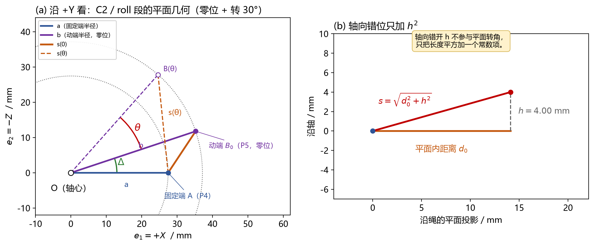
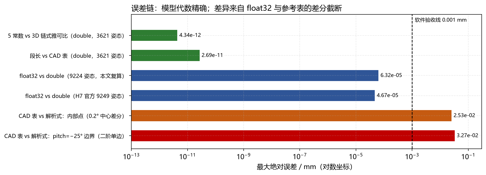
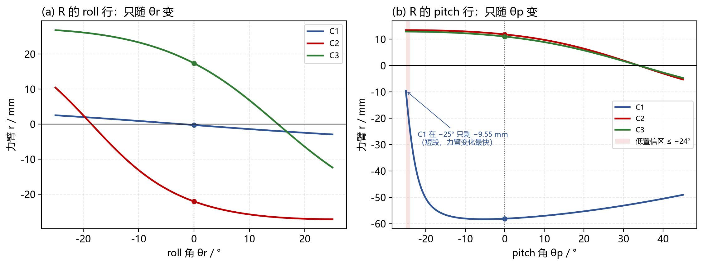
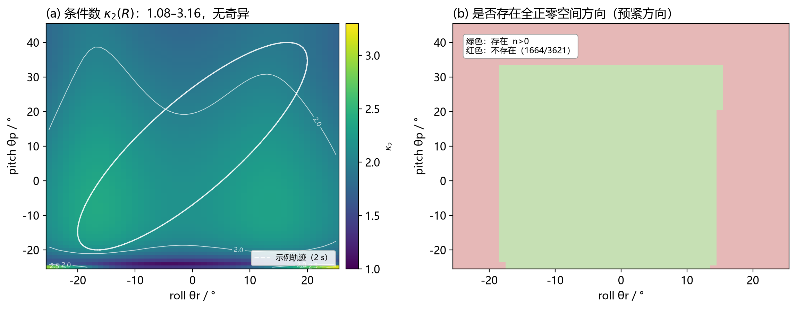

# 绳驱二轴腕部：动态 R 矩阵的验证与解算

> **版本** v1.0 ・ 2026-10-26  
> **对应模型** 2026-10-21 fixed-center-polyline v1（C2/C3 的 P03/P04 已修正）  
> **对应实现** H7 包 `wrist_r.c` / `wrist_default_model.c`，PC 镜像 `wrist_model.py`

> **一句话结论**：R 是 2×3、随位姿变化的力臂矩阵；6 个元素由「6 段 × 5 个几何常数」实时算出。当前模型与独立 3D 链式雅可比在 3,621 个姿态上的最大差为 **4.3×10�6�3�0�1�0�5 mm**（double）；float32 最大差 **6.3×10�6�3�6�7 mm**；与 0.2° 差分参考表的最大差 **0.0327 mm** 全部来自参考表的差分截断，不是模型误差。工作空间内 R 满行秩、条件数 **1.08�C3.16**，无奇异；但 **1,664/3,621** 个姿态不存在全正零空间预紧方向，张力分配必须逐姿态检查盒约束。

> **“动态”指什么**：本文的“动态 R”指 R 随关节角 θr、θp 变化，不是动力学方程里的惯性项。控制周期内它是时变量，但每个周期只需一次解析求值，不需要查表或迭代。

---

## 1. 结论与适用范围

### 1.1 五条结论

1. **R 的结构是 2×3**：两行对应 roll、pitch 两个关节，三列对应 C1、C2、C3 三根绳；定义是 $R_{ji}=-\partial l_i/\partial q_j$，$\tau=Rf$。
2. **R 可以实时算**：每段只需 5 个常数 $(u_1,u_2,v_1,v_2,h)$；整帧 2 次 sin + 2 次 cos、6 次开方、6 次除法，无动态分配。
3. **模型是代数精确的**：5 常数形式与独立 3D 刚体链式雅可比在 3,621 个姿态上最大差 $4.3\times10^{-12}$ mm（double），零位差 $2.9\times10^{-13}$ mm。
4. **误差来源已分清**：float32 约 $6\times10^{-5}$ mm；CAD 0.2° 差分表约 $3\times10^{-2}$ mm。后者是差分截断，不能当成模型误差，也不能当成 0.001 mm 级的真值。
5. **R 不奇异，但张力不一定可行**：条件数只有 1.08�C3.16；但零空间方向 n 是否全正、各分量比例是否够大，决定了给定 $\tau$ 能否找到满足 $f_{\min}\le f_i\le f_{\max}$ 的张力。

### 1.2 适用范围

- **几何模型**：固定中心折线模型（fixed-center polyline）。绳在导向点之间走直线，不含滑轮包角、绳弹性、摩擦、接触变形。
- **角度范围**：roll 为 $-25^\circ\sim+25^\circ$，pitch 为 $-25^\circ\sim+45^\circ$。pitch $\le -24^\circ$ 是当前 CAD 几何的**低置信区**，不是数学奇异边界。
- **解耦条件**：每根绳的 7 段中，只有 P4�CP5 随 θr、P6�CP7 随 θp；其余 5 段在同一个刚体上，长度不变。因此 $l_i(\theta_r,\theta_p)=c_i+s_{ri}(\theta_r)+s_{pi}(\theta_p)$。
- **不适用**：如果新增一根从 base 直接到 palm 的绳，$c_i$ 不再是常数，上面的解耦和“每行只依赖一个角”的结论立即失效，必须重推通用绳长雅可比。
- **轴线来源**：roll/pitch 轴不是 CAD 直接导出的，而是由 $(0^\circ,0^\circ)$、$(10^\circ,0^\circ)$、$(0^\circ,10^\circ)$ 三个姿态的刚体运动反求得到（见 `model_parameters.json` 的 `axis_provenance`）。这是当前模型的主要几何不确定度之一。

---

## 2. 当前模型：几何、解耦与 R 的定义

### 2.1 几何

腕部是 **3 绳 / 2 自由度**的冗余驱动：

- roll 轴：过原点，方向 $+Y$；
- pitch 轴：过 $(0,0,24)$ mm，方向 $+X$；
- 每根绳从 base 出发，经过 P1…P8 共 8 个导向点，形成 7 段；
- 只有两段会变：P4�CP5（随 θr）和 P6�CP7（随 θp）。

| 段 | 两端所在刚体 | 是否随角度变 |
|---|---|---|
| P1�CP2、P2�CP3、P3�CP4 | base | 不变 |
| P4�CP5 | base → roll_link | **随 θr 变** |
| P5�CP6 | roll_link | 不变 |
| P6�CP7 | roll_link → palm | **随 θp 变** |
| P7�CP8 | palm | 不变 |

不变 5 段之和记为 $c_i$。C1、C2、C3 的 $c_i$ 分别约为 80.675、61.260、61.260 mm。

### 2.2 为什么可以解耦

以 pitch 段 P6�CP7 为例：roll 旋转把 P6、P7 **一起**旋转，属于刚体变换，长度不变。写成矩阵：

$$(P_7-P_6)=Q_r\,x(\theta_p),\qquad \Vert Q_r x\Vert=\Vert x\Vert,$$

其中 $x(\theta_p)$ 只含 θp。所以 $s_{pi}$ 只由 θp 决定；同理 $s_{ri}$ 只由 θr 决定。这个性质不是二轴腕部的通性，而是当前绳路（没有 base→palm 直连绳）带来的。

### 2.3 R 的定义与物理意义

$$R_{ji}=-\frac{\partial l_i}{\partial q_j},\qquad R=\begin{bmatrix} r_{r,C1} & r_{r,C2} & r_{r,C3}\\ r_{p,C1} & r_{p,C2} & r_{p,C3} \end{bmatrix},\qquad \tau=Rf.$$

- 行 = 关节（roll、pitch），列 = 绳（C1、C2、C3）。
- $r=-\mathrm{d}s/\mathrm{d}\theta$ 就是“轴到绳的垂直距离”，带符号。
- $r>0$：正转时该段绳**变短**，张力产生**正**关节力矩；$r<0$ 反之。
- 单位：几何表用 mm，则 R 的单位是 mm；$\tau$ 用 N・mm。若 R 用 m，则 $\tau$ 用 N・m。**不要混用 mm 和 m**。

> 常见写法 $J=\partial l/\partial q$ 是 3×2；本文的 R 是 $-J^{\mathrm T}$，是 2×3。两者只差转置和负号，但矩阵乘法的顺序不能写反。

### 2.4 坐标系与符号

本文的模型坐标（与 CAD 修正数据一致）：

- $X$：pitch 轴正方向（零位）；
- $Y$：roll 轴正方向；
- $Z$：$X\times Y$，向上；
- roll 轴过原点；pitch 轴过 $(0,0,24)$ mm。

在垂直于 roll 轴的平面里，取右手平面基

$$e_1=+X,\qquad e_2=-Z,\qquad e_3=e_1\times e_2=+Y.$$

注意 $e_2=-Z$，所以 CAD 里的 $z$ 坐标要取负才能填进 $u_2,v_2$。例如 C2/roll 的 P4 是 $(-27,-16,+5)$，对应 $(u_1,u_2)=(-27,-5)$。这一步是符号错误的高发点。

| 符号 | 含义 | 单位 |
|---|---|---|
| $o$ | 轴心（roll 为原点，pitch 为 $(0,0,24)$） | mm |
| $\hat a$ | 轴方向单位向量（roll $+Y$，pitch $+X$） | ― |
| $A$ | 固定端（P4 / P6） | mm |
| $B_0$ | 动端零位（P5 / P7） | mm |
| $u,v$ | $A-o$、$B_0-o$ | mm |
| $u_\perp,v_\perp$ | 垂直于轴的分量 | mm |
| $a,b$ | 固定端、动端到轴的距离 | mm |
| $h$ | 两端沿轴的错开量，带符号 | mm |
| $\Delta$ | $u_\perp$ 与 $v_\perp$ 的有向夹角 | rad |
| $s$ | 该段绳长 | mm |
| $r$ | 力臂 $-\mathrm{d}s/\mathrm{d}\theta$ | mm |
| $\alpha,\beta,\gamma$ | 三个打包系数 | mm�0�5 |
| $R$ | 2×3 力臂矩阵 | mm（或 m） |
| $f$ | 三根绳张力 | N |
| $\tau$ | 两个关节力矩 | N・mm（或 N・m） |
| $n$ | R 的单位右零空间方向 | ― |
| $t$ | 零空间预紧参数 | N |

---

## 3. 从 3D 几何到 5 个常数

### 3.1 两个向量、两个半径、一个错位

$$u=A-o,\qquad v=B_0-o.$$

沿轴分解：

$$h_1=u\cdot\hat a,\qquad u_\perp=u-h_1\hat a,$$

$$h_2=v\cdot\hat a,\qquad v_\perp=v-h_2\hat a.$$

三个不变量：

$$a=\Vert u_\perp\Vert,\qquad b=\Vert v_\perp\Vert,\qquad h=h_2-h_1.$$



*平面几何：C2/roll 段的 a、b、Δ、s(θ)，以及轴向错位 h 只贡献 h�0�5。*

### 3.2 动端转过去，长度平方

绕轴转 θ：

$$v'_\perp=v_\perp\cos\theta+(\hat a\times v_\perp)\sin\theta.$$

动端位置 $B(\theta)=o+h_2\hat a+v'_\perp$，所以

$$B-A=h\hat a+v'_\perp-u_\perp.$$

轴向与两个垂直分量都正交，平方后轴向单独分离：

$$s^2=h^2+\Vert v'_\perp-u_\perp\Vert^2 =a^2+b^2+h^2-2\,v'_\perp\cdot u_\perp.$$

### 3.3 两角和，得到 α β γ

在右手平面 $(e_1,e_2)$ 里，$u_\perp=(u_1,u_2)$、$v_\perp=(v_1,v_2)$，定义

$$\cos\Delta=\frac{u_1v_1+u_2v_2}{ab},\qquad \sin\Delta=\frac{u_1v_2-u_2v_1}{ab}.$$

于是

$$v'_\perp\cdot u_\perp=ab\cos(\Delta+\theta),$$

$$s^2=\alpha+\beta\cos\theta+\gamma\sin\theta,$$

$$\alpha=a^2+b^2+h^2,\qquad \beta=-2ab\cos\Delta,\qquad \gamma=+2ab\sin\Delta.$$

> 这里 $\gamma=+2ab\sin\Delta$。如果 $\Delta$ 的符号或 $e_2$ 的方向取反，$\gamma$ 会反号，最终 $r$ 也反号。先用零位 $r(0)$ 对一遍，是最便宜的符号检查。

### 3.4 求导，得到力臂

$$s=\sqrt{\alpha+\beta\cos\theta+\gamma\sin\theta},$$

$$\frac{\mathrm{d}s}{\mathrm{d}\theta}=\frac{\gamma\cos\theta-\beta\sin\theta}{2s},$$

$$r=-\frac{\mathrm{d}s}{\mathrm{d}\theta} =\frac{\beta\sin\theta-\gamma\cos\theta}{2s},$$

$$r(0)=-\frac{\gamma}{2\sqrt{\alpha+\beta}}.$$

### 3.5 六段几何与零位力臂

| 段 | a / mm | b / mm | h / mm | Δ / ° | α / mm�0�5 | β / mm�0�5 | γ / mm�0�5 | **r(0) / mm** |
|---|---:|---:|---:|---:|---:|---:|---:|---:|
| C1 / roll | 5.025 | 18.173 | +3.000 | **+2.197** | 364.500 | �6�1182.500 | +7.000 | **�6�10.2594** |
| C2 / roll | 27.459 | 37.149 | +4.000 | **+18.488** | 2150.250 | �6�11935.000 | +647.000 | **�6�122.0497** |
| C3 / roll | 27.459 | 41.594 | +4.000 | **�6�115.150** | 2500.250 | �6�12205.000 | �6�1597.000 | **+17.3720** |
| C1 / pitch | 58.310 | 62.160 | �6�10.1785 | **+25.589** | 7263.474 | �6�16537.666 | +3130.772 | **�6�158.1046** |
| C2 / pitch | 13.416 | 25.298 | +0.2836 | **�6�133.830** | 820.330 | �6�1564.000 | �6�1378.000 | **+11.8049** |
| C3 / pitch | 13.416 | 25.298 | +6.2836 | **�6�133.830** | 859.733 | �6�1564.000 | �6�1378.000 | **+10.9904** |

> C1/roll 的 $r(0)$ 只有 �6�10.259 mm，说明零位时 C1 绳段的延长线离 roll 轴只有 0.259 mm；它的力矩贡献很小，但对几何误差最敏感。C1/pitch 的 �6�158.1 mm 则是 pitch 的主力矩臂。

### 3.6 手算一遍 C2 / roll（θ = 30°）

在 $(e_1,e_2)$ 平面里：

$$u=(-27,-5),\qquad v=(-32.5,-18).$$

转 30°：

$$v'_1=v_1\cos30^\circ-v_2\sin30^\circ=-19.146,$$

$$v'_2=v_1\sin30^\circ+v_2\cos30^\circ=-31.838.$$

差向量：

$$d=v'-u=(7.854,\,-26.838),$$

$$s=\sqrt{7.854^2+26.838^2+4^2}=28.249\ \text{mm}.$$

力臂：

$$r=\frac{d_1v'_2-d_2v'_1}{s} =\frac{7.854\times(-31.838)-(-26.838)\times(-19.146)}{28.249} =-27.042\ \text{mm}.$$

对应的 3D 点是 $B=(-19.146,-12,31.838)$，其二分量 $-Z=-31.838$，与上面一致。这一步同时验证了“$e_2=-Z$”的符号约定。

C2 / roll 的完整扫描：

| θ / ° | 0 | 10 | 20 | 25 | 30 | 40 |
|---|---:|---:|---:|---:|---:|---:|
| s / mm | 14.671 | 18.894 | 23.521 | 25.884 | 28.249 | 32.922 |
| r / mm | �6�122.050 | �6�125.753 | �6�126.993 | **�6�127.124** | �6�127.042 | �6�126.418 |

> 注意：25° 的 s 是 25.884 mm，但 r(25°) 是 **�6�127.124** mm；�6�126.993 mm 是 20° 的值。s 和 r 不要跨行抄。

---

## 4. 实时解算：固件形式与符号

### 4.1 五步公式

每个关节角只需算一次 sin/cos，然后对三根绳各做一次：

$$v'_1=v_1\cos\theta-v_2\sin\theta,$$

$$v'_2=v_1\sin\theta+v_2\cos\theta,$$

$$d_1=v'_1-u_1,\qquad d_2=v'_2-u_2,$$

$$s=\sqrt{d_1^2+d_2^2+h^2},$$

$$r=\frac{d_1v'_2-d_2v'_1}{s}.$$

roll 段用 θr，pitch 段用 θp。六个 $(s,r)$ 组合成 R 的两行。

### 4.2 符号怎么来的

因为 $\mathrm{d}v'/\mathrm{d}\theta=(-v'_2,\,v'_1)$，所以

$$\frac{\mathrm{d}s}{\mathrm{d}\theta} =\frac{d_1(-v'_2)+d_2(v'_1)}{s} =\frac{-d_1v'_2+d_2v'_1}{s},$$

$$r=-\frac{\mathrm{d}s}{\mathrm{d}\theta} =\frac{d_1v'_2-d_2v'_1}{s}.$$

> **符号陷阱**：写成 $(u_1d_2-u_2d_1)/s$ 会得到**相反**的符号。它等于 $-r$，在闭环里表现为“控制方向反、越纠越偏”。旧稿的算法段就是这个写法，本文已改正。

### 4.3 零位矩阵

单位 mm：

$$R(0)=\begin{bmatrix} -0.2594 & -22.0497 & +17.3720\\ -58.1046 & +11.8049 & +10.9904 \end{bmatrix}.$$

单位 m（固件 SI 口径）时整体乘 $10^{-3}$：

$$R(0)=\begin{bmatrix} -2.594\times10^{-4} & -2.205\times10^{-2} & +1.737\times10^{-2}\\ -5.810\times10^{-2} & +1.180\times10^{-2} & +1.099\times10^{-2} \end{bmatrix}\ \text{m}.$$

零位右零空间方向：

$$n(0)=(0.26444,\ 0.59491,\ 0.75905),$$

三根绳全正，说明零位存在“三绳一起收紧”的内部预紧方向。零位条件数 $\kappa_2=2.1498$。

### 4.4 计算量与结构

- 整帧 **2 次 sin + 2 次 cos**（每轴一对，不是每段一对）；6 次 `sqrt`、6 次除法；约 30 次乘法加法。
- 30 个 float 常数（6 段 × 5），120 字节；无堆内存、无查表、无迭代。
- **行可分离**：roll 行只依赖 θr，pitch 行只依赖 θp。因此可以只更新一行，或把两行放在不同任务里算。
- 这套结构适合 1 kHz 控制；但实际最坏执行时间必须在 H7 目标板、实际编译选项和中断负载下用 DWT 测量，主机时间不能代替。

C 语言形态：

```c
for (j = 0; j < 2; ++j) {
    float th = (j == 0) ? roll_rad : pitch_rad;
    float c = cosf(th), s = sinf(th);
    for (i = 0; i < 3; ++i) {
        float v1p = seg[j][i].v1 * c - seg[j][i].v2 * s;
        float v2p = seg[j][i].v1 * s + seg[j][i].v2 * c;
        float d1  = v1p - seg[j][i].u1;
        float d2  = v2p - seg[j][i].u2;
        float len = sqrtf(d1*d1 + d2*d2 + seg[j][i].h*seg[j][i].h);
        R[j][i] = (d1*v2p - d2*v1p) / len;
        seg_len[j][i] = len;
    }
}
```

### 4.5 运行期诊断

| 标志 | 含义 | 处理 |
|---|---|---|
| `math_valid` | 六段都有限、段长大于数值下限 | 否则 R 全部置 NaN，不得沿用旧帧 |
| `angle_in_range` | 两个角都在模型行程内 | 越界仍给数学结果，但控制不得使用 |
| `low_pitch_zone` | pitch ≤ �6�124° | 提示低置信区；C1 pitch 在 �6�125° 只有 3.9006 mm |
| `rank_2` | 两行数值独立 | 当前工作空间 3,621/3,621 为真 |
| `has_positive_internal_preload` | 存在全正 n | 当前工作空间 1,957/3,621 为真 |
| `condition_2` | $\kappa_2(R)$ | 当前工作空间 1.08�C3.16 |

---

## 5. 验证：四条独立路线与结果

### 5.1 路线

| 路线 | 做什么 | 独立性 |
|---|---|---|
| A. 5 常数固件式 | 直接算 $s,r$ | 生产路径 |
| B. 3D 刚体 FK + 链式雅可比 | 24 个 CAD 点，逐段 $u_k$ 投影 | 不调用 A 的平面常数 |
| C. α β γ 闭式 | $\sqrt{\alpha+\beta\cos\theta+\gamma\sin\theta}$ | 代数等价性检查 |
| D. CAD 0.2° 差分表 | 3,621 个 1° 网格姿态 | 外部参考，含差分截断 |
| E. float32 模拟 | 常数、角度、运算全用 float32 | 数值格式检查 |

B 的定义是

$$R_{ji}=-\sum_{k=1}^{7}u_k\cdot \left(\frac{\partial p_{k+1}}{\partial q_j}-\frac{\partial p_k}{\partial q_j}\right),$$

其中 $p_k$ 是第 k 个导向点的世界坐标，$u_k$ 是该段单位方向。它和 A 的平面投影是两条不同的计算路径。

### 5.2 零位：三条路线一致

| 元素 | A（5 常数） | B（3D 链式） | C（αβγ） | A�6�1B |
|---|---:|---:|---:|---:|
| roll / C1 | �6�10.259437 | �6�10.259437 | �6�10.259437 | $<3\times10^{-13}$ |
| roll / C2 | �6�122.049701 | �6�122.049701 | �6�122.049701 | $<3\times10^{-13}$ |
| roll / C3 | +17.371982 | +17.371982 | +17.371982 | $<3\times10^{-13}$ |
| pitch / C1 | �6�158.104616 | �6�158.104616 | �6�158.104616 | $<3\times10^{-13}$ |
| pitch / C2 | +11.804884 | +11.804884 | +11.804884 | $<3\times10^{-13}$ |
| pitch / C3 | +10.990351 | +10.990351 | +10.990351 | $<3\times10^{-13}$ |

最大差 $2.9\times10^{-13}$ mm；αβγ 与 5 常数的系数闭合差 $8.7\times10^{-19}$ m�0�5。

### 5.3 全工作空间：3,621 个姿态

| 指标 | 结果 |
|---|---|
| 姿态数 | 3,621（roll �6�125…25°，pitch �6�125…45°，1° 网格） |
| A vs B 最大差 | **4.34×10�6�3�0�1�0�5 mm** |
| A vs B RMS | 6.24×10�6�3�0�1�0�6 mm |
| 段长 vs CAD 表最大差 | **2.69×10�6�3�0�1�0�1 mm** |
| 满行秩 | 3,621 / 3,621 |
| 条件数范围 | **1.0836 �C 3.1637** |
| 全正零空间方向 | 1,957 / 3,621 |
| 无全正零空间方向 | **1,664 / 3,621** |

这说明：**5 常数形式不是拟合，而是同一几何的等价改写**；double 下它与 3D 链式雅可比只差浮点舍入。

### 5.4 float32：比验收线低约 16 倍

| 指标 | 本文独立复算（9,224 姿态） | H7 官方（9,249 姿态） |
|---|---:|---:|
| R 最大绝对差 | **6.32×10�6�3�6�7 mm** | **4.67×10�6�3�6�7 mm** |
| R RMS | 2.98×10�6�3�6�8 mm | ― |
| 段长最大差 | 3.30×10�6�3�6�7 mm | 1.10×10�6�3�6�7 mm |
| 含角度 float 舍入的最大差 | ― | 4.90×10�6�3�6�7 mm |

两套数字来自不同的姿态集合和编译器，不能逐位比较；结论一致：**float32 误差比 0.001 mm 的软件验收线低约一个数量级以上**。这是软件数值误差，不含几何、标定、摩擦、弹性误差。

### 5.5 与 CAD 0.2° 差分表的 0.0327 mm 是什么

最大差出现在：

- 姿态：roll = +4°，pitch = �6�125°；
- 元素：pitch / C1；
- 数值：解析式 �6�19.550513 mm，表值 �6�19.583181 mm，差 **�6�10.032668 mm**。

这个点正好在 pitch 下边界。参考表的生成方式是：

- 内部点：主体是 0.2° 中心差分；
- 边界点：0.2° 二阶单边差分。

用 3D 长度直接做二阶单边差分：

$$r_{\text{2nd,fwd}}=-\frac{-3L(\theta_0)+4L(\theta_0+h)-L(\theta_0+2h)}{2h},\qquad h=0.2^\circ,$$

得到 �6�19.583181100 mm，与表值 �6�19.583181100 mm 相差 **8.7×10�6�3�0�1�0�1 mm**。所以表值本身没有错，它只是**差分近似**；它与解析式的差就是差分截断：

$$r_{\text{2nd,fwd}}-r_{\text{exact}}=-0.032668\ \text{mm}.$$

中心差分的步长扫描（同一元素）验证了 $O(h^2)$：

| 步长 h / ° | 0.4 | 0.2 | 0.1 | 0.05 | 0.01 | 0.001 |
|---|---:|---:|---:|---:|---:|---:|
| 与解析式差 / mm | 0.053681 | 0.013502 | 0.003381 | 0.000846 | 3.38×10�6�3�6�7 | 3.38×10�6�3�6�9 |

内部点的最大差也有 **0.025266 mm**，同样来自 0.2° 中心差分在短段附近的截断。

> 结论：**0.0327 mm 是参考表的差分误差，不是 R 模型的误差**。在 pitch ≤ �6�124° 的短段区，不能把这张表当成 0.001 mm 级的真值；要做微米级验收，必须用解析式或更小步长的差分。

### 5.6 误差链



*误差链：同一批姿态下，模型、float32、CAD 差分表的误差量级。绿：代数/长度；蓝：float32；橙/红：参考表差分截断。*

### 5.7 还没有验证什么

- 没有在 H7 目标工程里编译/链接，也没有 DWT 周期和中断最坏时延；
- 没有实机标定零位 δr、δp 和每绳收放系数 $k_i$；
- 没有真实绳长门限、张力上下限、摩擦、弹性、接触变形；
- 轴线是刚体运动反求的，不是 CAD 直接导出；
- CAD 表本身是差分参考，不是测量真值。

这些必须在实机上单独验证，不能由本文的软件对拍替代。

---

## 6. 动态特性：R 随位姿怎么变

### 6.1 两条曲线



*R 随角度变化：左：roll 行只随 θr 变；右：pitch 行只随 θp 变。低置信区用浅红标出。*

### 6.2 工作空间内的极值

| 元素 | 最小 / mm | 最大 / mm | 变化量 / mm |
|---|---:|---:|---:|
| roll / C1 | �6�12.936 | +2.527 | 5.463 |
| roll / C2 | �6�127.124 | +10.427 | **37.551** |
| roll / C3 | �6�112.370 | +26.818 | 39.188 |
| pitch / C1 | �6�158.307 | �6�19.551 | **48.756** |
| pitch / C2 | �6�15.295 | +13.415 | 18.710 |
| pitch / C3 | �6�14.726 | +12.883 | 17.609 |

最醒目的两个数：

- C2 对 roll 的力臂在 �6�125°…+25° 内从 **+10.427 mm** 变到 **�6�127.124 mm**，变化 **37.55 mm**；
- C1 对 pitch 的力臂在 �6�125°…+45° 内从 **�6�19.551 mm** 变到 **�6�158.307 mm**（最小值在 �6�15.5° 附近），变化 **48.76 mm**。

用零位常数代替动态 R，在这两个元素上会产生几十毫米的力臂误差，力矩方向甚至可能反。

### 6.3 条件数与零空间



*工作空间诊断：左：条件数 κ�6�0(R)；右：是否存在全正零空间方向。白色虚线是 2 s 示例轨迹。*

- 条件数只有 1.08�C3.16，**没有奇异**；R 的两行在整个工作空间内都线性独立。
- 但 1,664/3,621 个姿态**不存在全正 n**。这不是秩亏，而是三根绳的零空间方向有正有负：想让三根绳同时收紧，数学上做不到。
- 这个性质逐姿态变化，不能按 pitch 一个角度硬编码；必须实时算 n 并检查符号。

### 6.4 一条 2 s 轨迹

轨迹：$\theta_r=20\sin(2\pi t)$，$\theta_p=10+30\sin(2\pi t+0.6)$，单位度。

| t / s | θr / ° | θp / ° | r(C2, roll) / mm | r(C1, pitch) / mm | κ�6�0 | n |
|---:|---:|---:|---:|---:|---:|---|
| 0.00 | 0.00 | 26.94 | �6�122.050 | �6�153.847 | 1.925 | (0.082, 0.616, 0.783) |
| 0.25 | 20.00 | 34.76 | �6�126.993 | �6�151.940 | 1.881 | (�6�10.006, �6�10.232, 0.973) |
| 0.50 | 0.00 | �6�16.94 | �6�122.050 | �6�158.282 | 2.169 | (0.283, 0.591, 0.755) |
| 0.75 | �6�120.00 | �6�114.76 | +2.559 | �6�156.761 | 2.305 | (0.202, 0.973, �6�10.111) |

轨迹内条件数 1.875�C2.375；R 的 C2/roll 元素从 �6�126.99 变到 +2.56，n 的符号也会翻转。这说明：

1. **R 必须逐周期更新**，不能用零位常数或粗网格插值；
2. **n 的符号/比例也要逐周期更新**，预紧策略不能假设“永远三正”；
3. 轨迹全程没有奇异，但接近工作空间边界时 n 会先出问题（某个分量变负），比条件数更早失效。

---

## 7. 解算 I：张力分配 τ �6�2 f

### 7.1 正解（观测）

已知三根绳张力 $f$，关节力矩直接是

$$\tau=Rf.$$

内预紧分量（如果 n 存在）是 $f\cdot n$。这个方向永远可算，不依赖张力上下限；`wrist_tension.py` 里当 n 不存在时把 preload 置 NaN，但 τ 照常算。

> 当前 v2 控制律（`wrist_control_law.py`）是：前馈 $=k_i\,[l_i(\text{目标})-l_i(\text{基线})]$，校正 $=-k_p\,k_i\,(R_i\cdot e_{\text{rad}})$。R 在这里直接决定 P 校正的方向和大小；R 的符号错，闭环会正反馈。

### 7.2 反解（分配）

R 是 2×3，$\tau$ 只有 2 维，所以 $f$ 有 1 维自由度。最小范数特解：

$$f_p=R^{\mathrm T}(RR^{\mathrm T})^{-1}\tau.$$

右零空间单位向量：

$$n=\frac{(R_1/\Vert R_1\Vert)\times(R_2/\Vert R_2\Vert)} {\Vert (R_1/\Vert R_1\Vert)\times(R_2/\Vert R_2\Vert)\Vert}.$$

通解：

$$f=f_p+t\,n,\qquad t\in\mathbb R.$$

加上每根绳的上下限 $f_{\min}\le f_i\le f_{\max}$，得到 t 的可行区间：

$$t_{\text{lo}}=\max_i\min\left(\frac{f_{\min}-f_{p,i}}{n_i},\frac{f_{\max}-f_{p,i}}{n_i}\right),$$

$$t_{\text{hi}}=\min_i\max\left(\frac{f_{\min}-f_{p,i}}{n_i},\frac{f_{\max}-f_{p,i}}{n_i}\right).$$

- 可行 $\iff t_{\text{lo}}\le t_{\text{hi}}$；
- 取 $t=(t_{\text{lo}}+t_{\text{hi}})/2$，让上下限都留余量；
- 若 $n_i\approx0$，该绳的张力几乎不随 t 变，要单独检查 $f_{p,i}$ 是否已经在盒内。

### 7.3 算例

取示例负载 $\tau=[0.10,\ 0.20]$ N・m，示例张力盒 $[f_{\min},f_{\max}]=[5,40]$ N。**这两个阈值不是实机标定值，只用于演示算法**；实机必须实测。

| 姿态 (θr, θp) / ° | n | 可行？ | t 区间 / N | 取中点后的 f / N |
|---|---|---:|---|---|
| (0, 0) | (0.264, 0.595, 0.759) | �7�3 | [31.55, 48.88] | (7.29, 21.71, 33.42) |
| (5, 10) | (0.212, 0.446, 0.870) | �7�3 | [40.78, 43.34] | (5.27, 15.98, 38.89) |
| (10, 20) | (0.128, 0.248, 0.960) | �7�4 | [69.11, 40.23]，空 | ― |
| (15, 30) | (0.032, 0.005, 0.999) | �7�4 | [1602.8, 39.9]，空 | ― |
| (�6�120, �6�120) | (0.229, 0.967, �6�10.112) | �7�4 | n 有负分量 | ― |
| (0, 44) | (�6�10.129, 0.615, 0.778) | �7�4 | n 有负分量 | ― |

### 7.4 怎么读这张表

1. **“n 全正”是必要条件，不是充分条件。**  
   (10,20) 的 n 全正，但 C3 分量 0.960 太大：要把 C1 抬到 5 N，需要 t≈69 N，此时 C3 已经超过 40 N，区间为空。
2. **n 的分量比例决定哪根绳先饱和。**  
   (15,30) 的 n2 只有 0.0053，几乎无法通过零空间给 C2 加预紧；要把 C2 从 $f_{p,2}=-3.48$ N 抬到 5 N，需要 t≈1603 N，C1 早就过载。这个姿态要换 $\tau$ 方向，或降低负载，或改绳路，不能靠“加大预紧”解决。
3. **n 有负分量时，不存在“三绳一起收紧”的方向。**  
   (�6�120,�6�120) 和 (0,44) 属于这一类；这时预紧只能让部分绳变紧、部分绳变松，必须用盒约束逐根检查。
4. **可行区间可能很窄。**  
   (5,10) 只有 [40.78, 43.34]，约 2.6 N 的余量；实际控制要留采样噪声和张力波动裕量。

> 如果区间为空，正确的做法是：降低 $\tau$、改变 $\tau$ 的方向（例如把负载分到另一个关节）、换姿态，或改绳路/滑轮布置；**不是简单加大 t**。加大 t 只会让先饱和的那根绳过载。

---

## 8. 解算 II：绳长 → 角度（扩展）

R 是绳长对角度的雅可比，所以也可以拿它做反解。因为 $l$ 对两个角可分离，每个关节是一个“3 个方程、1 个未知数”的最小二乘问题。Gauss-Newton 一步：

$$\Delta\theta_j=-\frac{r_j\cdot(l-l^*)}{r_j\cdot r_j},\qquad j=r,p.$$

目标 $(15^\circ,30^\circ)$，从零位出发：

| 迭代 | θr / ° | θp / ° | 三绳残差范数 / mm |
|---:|---:|---:|---:|
| 0 | 0.000 | 0.000 | 30.368 |
| 1 | 12.304 | 27.742 | 2.477 |
| 2 | 15.102 | 30.009 | 0.0484 |
| 3 | 14.999 | 29.998 | 1.85×10�6�3�0�6 |
| 4 | 15.000 | 30.000 | 7.04×10�6�3�6�7 |
| 5 | 15.000 | 30.000 | 2.68×10�6�3�6�8 |

3 步到 0.002 mm，4 步到 $7\times10^{-5}$ mm，5 步到 $2.7\times10^{-6}$ mm，呈二次收敛。这验证了 R 作为雅可比的正确性，也说明模型在行程内可逆。

> 实机上做这件事要注意：测得的是绝对绳长，必须先减去 $c_i$ 和零位偏置；并且要用标定后的 $k_i$ 把电机 counts 换成绳长。不要直接把 counts 当 mm。

---

## 9. 工程落地清单

### 9.1 必须标定

| 项 | 符号 | 说明 |
|---|---|---|
| 机械零位 | δr, δp | 基线零位对应的模型角；全链只校正一次 |
| 每绳收放系数 | $k_i$ | counts/m，带符号；由台架点动确认 |
| 张力下限 | $f_{\min}$ | 防松绳；必须实测，不能编造 |
| 张力上限 | $f_{\max}$ | 防过载；必须实测 |
| 段长门限 | $s_{\min}$ | 按几何不确定度和允许力臂误差定；不是 1e-8 m 的数值下限 |

### 9.2 运行时必须做

- 每周期重算 R 和 n；不要缓存上一帧的 R 当本帧用。
- 检查 `math_valid`、`angle_in_range`、`low_pitch_zone`、`rank_2`、`has_positive_internal_preload`。
- 张力分配先算 $f_p$ 和 t 区间，再判可行；不可行时保持上一安全目标，不要硬发。
- 段长小于工程门限时把 R 置 NaN，禁止用“上一帧的 R”继续算。
- 角度接口统一 rad；deg 只在 UI/标定入口转换一次。

### 9.3 不要做

| 错误 | 后果 |
|---|---|
| 用零位 R 常数 | 力臂差几十毫米，力矩方向可能反 |
| 把 pitch 轴心当原点 | a、b、h 全错，pitch 行整体偏 |
| 用 $\Vert v\Vert$ 当 b | 少减了轴向分量 h |
| 角度用度直接喂 sin/cos | 结果完全错 |
| 力臂符号取反 | 闭环正反馈，越纠越偏 |
| 把 CAD 差分表当 0.001 mm 真值 | 在 pitch ≤ �6�124° 会把 0.03 mm 的差分误差当成模型误差 |
| 只看“n 全正”就认为张力可行 | 分量比例可能让盒约束为空 |
| 用 counts 直接当 mm | 标定系数没乘，量纲错 |

### 9.4 建议的验收顺序

1. **代数对拍**：5 常数 vs 3D 链式，double，要求 $<10^{-9}$ mm；
2. **数值格式**：float32 vs double，要求 $<10^{-3}$ mm；
3. **参考表**：与 CAD 表比，先确认差分步长和边界格式，再解释差异；
4. **矩阵性质**：rank、条件数、n 的符号与比例；
5. **张力盒**：全工作空间扫 $\tau$ 方向，统计可行域；
6. **实机**：零位、$k_i$、$f_{\min}/f_{\max}$、段长门限、周期与最坏时延。

---

## 10. 复现、文件与版本

### 10.1 复现命令

```text
python verify_dynamic_R.py     # 独立复算，输出 out/verify_summary.json 与 CSV
python make_figures.py         # 生成 out/figs/*.png
```

H7 官方主机验证：

```text
python tools/verify_host.py    # 需 GCC/Clang/Zig cc
```

### 10.2 文件与数据

| 文件 | 用途 |
|---|---|
| `复核数据_extracted/复核数据/points_zero.csv` | 24 个 CAD 零位点（mm） |
| `复核数据_extracted/复核数据/model_parameters.json` | 轴线、刚体归属、绳段常数 |
| `复核数据_extracted/复核数据/segment_parameters.csv` | 六段 αβγ 与常数长度 |
| `复核数据_extracted/复核数据/R_grid_corrected.csv` | 3,621 姿态的 0.2° 差分参考表 |
| `H7_.../data/derived_constants.json` | 固件 30 个投影常数 + αβγ |
| `H7_.../src/wrist_r.c` | 固件实现 |
| `code/mmhand-main/wrist_model.py` | PC 镜像 |
| `code/mmhand-main/wrist_tension.py` | τ=Rf、预紧、松绳/过载判定 |
| `out/verify_summary.json` | 本文全部数值 |
| `out/figs/fig1…fig4.png` | 本文图 |

数据溯源：

- 几何源 SHA256：`952e9c40702d5e140a9f2cd77b88f1416bbfe2941dac7699dba0e74b6d87a59f`；
- CAD 差分表 SHA256：`32e7111d503728a95ed460259a30bd8fc4c9610dd9039dd6c847736cf63bec09`；
- 模型版本：`2026-10-21 fixed-center-polyline v1`。

### 10.3 与旧稿的差异（勘误）

| 项 | 旧稿 | 本文 |
|---|---|---|
| 固件力臂公式 | $(u_1d_2-u_2d_1)/s$ | $(d_1v'_2-d_2v'_1)/s$（旧式差一个负号） |
| C1/roll 的 Δ | �6�117.80° | **+2.197°** |
| C3/roll 的 Δ | �6�10.10° | **�6�115.150°** |
| C2/roll 25° 的 r | �6�126.99 mm | **�6�127.124 mm**（�6�126.993 是 20°） |
| sin/cos 次数 | “每段 2 次” | **整帧 2 组**（每轴一对） |
| CAD 0.0327 mm | 笼统称“差分截断” | 定位到 pitch=�6�125° 边界的二阶单边差分，截断值 �6�10.032668 mm |

### 10.4 飞书导入说明

1. 飞书云文档 → 新建 → 导入 → 选择 `飞书_动态R矩阵_验证与解算.md`。
2. 如果公式被当成 LaTeX 源码：用浏览器打开 `飞书_动态R矩阵_验证与解算.html`，复制渲染后的公式/段落；或在飞书公式块里粘贴对应的 `$$...$$` 内容。
3. 图片在 `out/figs/`。如果导入时丢失，按图注位置重新插入 `fig1_geometry.png`、`fig2_R_curves.png`、`fig3_error_chain.png`、`fig4_workspace.png`。
4. 表格较多，导入后建议先检查第 3.5 节（六段几何）、第 5.3 节（验证汇总）、第 7.3 节（张力算例）三张表。

---

## 附录 A：六段 αβγ 与常数长度

| 段 | α / mm�0�5 | β / mm�0�5 | γ / mm�0�5 | c / mm |
|---|---:|---:|---:|---:|
| C1 / roll | 364.500 | �6�1182.500 | +7.000 | 80.6755 |
| C2 / roll | 2150.250 | �6�11935.000 | +647.000 | 61.2596 |
| C3 / roll | 2500.250 | �6�12205.000 | �6�1597.000 | 61.2596 |
| C1 / pitch | 7263.474 | �6�16537.666 | +3130.772 | 80.6755 |
| C2 / pitch | 820.330 | �6�1564.000 | �6�1378.000 | 61.2596 |
| C3 / pitch | 859.733 | �6�1564.000 | �6�1378.000 | 61.2596 |

> 固件不直接存 αβγ：C1/pitch 的 $\alpha+\beta$ 只有约 725.8 mm�0�5，两个 7,000 量级的数相加后只剩约 1/10，float32 会掉精度。固件存 5 个投影数，直接算差向量，避免大数抵消。

## 附录 B：30 个投影常数（mm）

| 轴 | 绳 | u�6�9 | u�6�0 | v�6�9 | v�6�0 | h |
|---|---|---:|---:|---:|---:|---:|
| roll | C1 | +0.500000 | �6�15.000000 | +2.500000 | �6�118.000000 | +3.000000 |
| roll | C2 | �6�127.000000 | �6�15.000000 | �6�132.500000 | �6�118.000000 | +4.000000 |
| roll | C3 | +27.000000 | �6�15.000000 | +37.500000 | �6�118.000000 | +4.000000 |
| pitch | C1 | +6.000000 | �6�158.000000 | +32.472169 | �6�153.000000 | �6�10.178543 |
| pitch | C2 | +6.000000 | +12.000000 | +22.000000 | +12.500000 | +0.283587 |
| pitch | C3 | +6.000000 | +12.000000 | +22.000000 | +12.500000 | +6.283587 |

> 再次提醒：$u_2,v_2$ 是 $e_2=-Z$ 分量；roll 段的 $u_2=-5$ 对应 CAD 的 $z=+5$。不要直接把 CAD 的 z 填进来。

## 附录 C：本文用到的关键数值（速查）

| 量 | 数值 |
|---|---|
| R(0) / mm | [�6�10.2594, �6�122.0497, +17.3720; �6�158.1046, +11.8049, +10.9904] |
| n(0) | (0.26444, 0.59491, 0.75905) |
| κ�6�0(0) | 2.1498 |
| 3D 对拍最大差 | 4.34×10�6�3�0�1�0�5 mm |
| float32 最大差 | 6.32×10�6�3�6�7 mm |
| CAD 表最大差 | 0.032668 mm（差分截断） |
| 条件数范围 | 1.0836�C3.1637 |
| 全正 n 的姿态 | 1,957 / 3,621 |
| 无全正 n 的姿态 | 1,664 / 3,621 |
| C2/roll 力臂变化 | +10.427 → �6�127.124 mm |
| C1/pitch 力臂变化 | �6�19.551 → �6�158.307 mm |
| 低置信区 | pitch ≤ �6�124°；�6�125° 时 C1 pitch 段 3.9006 mm |

---

*文档完。数值由 `verify_dynamic_R.py` 生成，图由 `make_figures.py` 生成；所有数值可在 `out/verify_summary.json` 中复核。*
